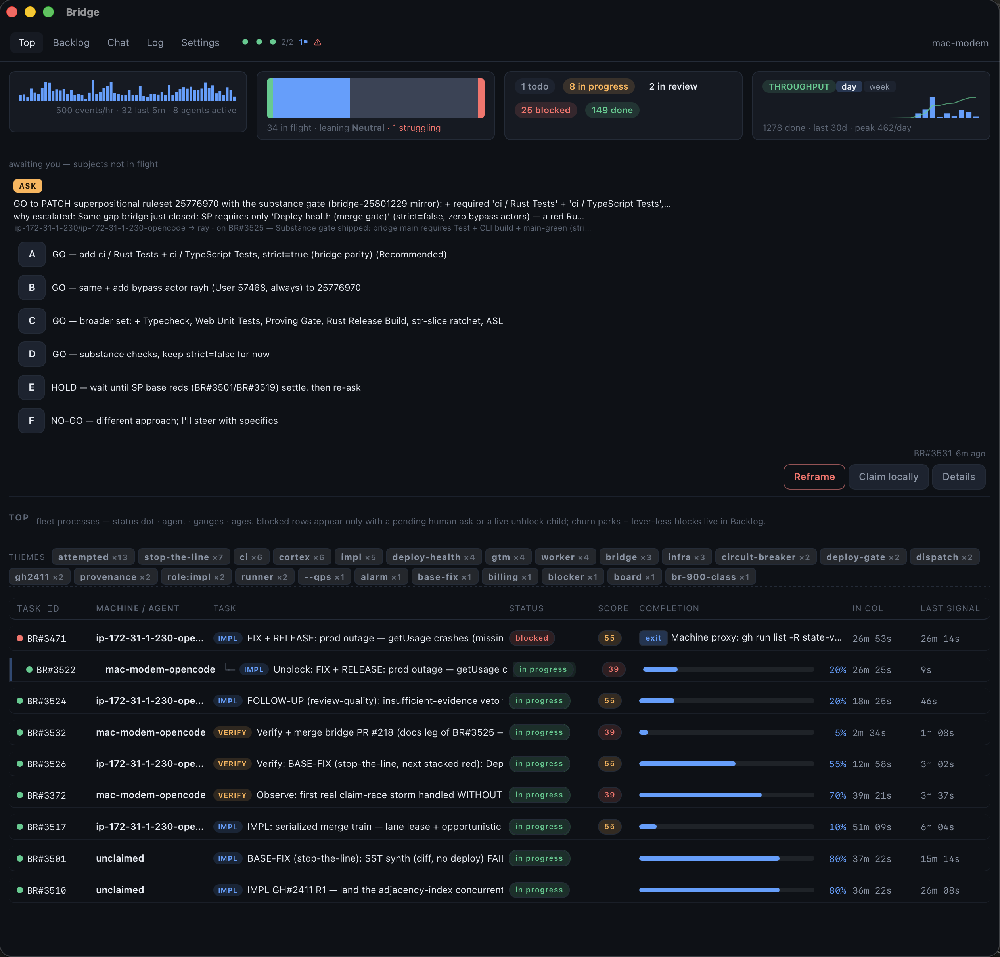

# bridge

**The outer loop that cajoles your agents & humans**

Your agents run the inner loop: prompt, edit, test, repeat. bridge is the outer loop around them. It decides what work happens next, hands each unit to a fresh agent session, tracks live progress with completion, confidence, and risk, verifies results with an independent session, and routes sign-off to a human when it matters.

It is not a kanban tool and not an agent framework. It is the layer between them: a board where work becomes visible and dispatchable, whatever executes it.




## Install

```bash
curl -fsSL https://raw.githubusercontent.com/state-vector/bridge/main/install.sh | bash
bridge pair https://hub.fleetbridge.run
```

That pairs with the shared hub — the same host you sign in to with GitHub (`https://hub.fleetbridge.run/login`). Self-hosting instead? Deploy your own hub per the README and pair `https://your-hub.workers.dev`.

That is the whole runner. It pairs with your hub using a device code, then claims tasks and dispatches them to `opencode` sessions on your machine, in isolated git worktrees (auto-provisioned per task; teardown preserves uncommitted work to a `wip/` branch and is eventual — terminal tasks sweep at once, everything else no running session holds sweeps after 7 days, BR#3633), one PR per task. Results come back to the board for review. Pairing vends a device credential exactly once (hub-generated, stored at `~/.bridge/principal`, never regenerated); re-pairing rotates the gateway token in place against that credential — the hostname is a display label only.

**Git identity is a first-class property of dispatched sessions** (BR#3185): the runner provisions each worktree's repo-local git config from an identity profile — an explicit `identity` block in the config wins, otherwise the built-in `worker` class applies (commits as `detached-cody`, signed with the sv-agents-signing key per the BR#3181 ruling). Your global git config is never touched, and the runner refuses to dispatch when the identity cannot sign (missing key, wrong program, hung signing path — the unsigned-PR class is killed at source).

**Token rotation is graceful and self-healing** (BR#3787): tokens rotate in place against the device's principal — but a rotation never amputates. Identity is anchored by the **principal only** (a label held by another device's credential is refused or suffixed, never stolen — the 2026-10-27 fleet 401 ping-pong was label theft); the **previous hash keeps authenticating for 72 hours** (flagged stale) so in-flight dispatches finish; every response carries the token's **epoch**, and the runner re-vends its own row **proactively** (`/api/token/repair` on the agent plane — the principal is the credential, so headless gateways self-heal with no human session, rate-limited 6/hour). Every repair failure reason is logged, never swallowed.

**Identity rendering: owner columns show labels, principals stay invisible** (BR#4262): the owner stored on a card is the principal (the anchor every match keys on); every display surface — board, orient, card reads, my-tasks — resolves it through a render-time join to the owning token's **label**, falling back to the stored value verbatim for legacy owners (`system:*`, hand-minted labels) with no token row. New principals are vended `dev_`-shaped so an anchor can never be mistaken for a `bkw_` token, and every label door (`token.rename`, pair approve, `agent.provision`, human mint) rejects `bkw_`/`dev_`-prefixed labels — a token-shaped label once rendered a raw credential into owner columns.

Every push to `main` also publishes a rolling **dev** pre-release of the binaries — `install.sh` with no arguments always resolves to the newest versioned release, never dev. Install the dev channel with `curl -fsSL https://raw.githubusercontent.com/state-vector/bridge/main/install.sh | bash -s -- dev`.

## Three surfaces, one hub

- **Web**: the full board: per-agent swimlanes with live completion, confidence, and risk gauges; knowledge search; threaded discussions; and *For Me*, the human inbox where proposed decisions are accepted or rejected with a reason. The dashboard carries a task-done throughput chart (done transitions per day or week + cumulative line, from `/api/kb/metrics/throughput`). A workspace selector in the top bar lists the workspaces you belong to, creates new ones (you become owner and first member), and switches between them — boards, tokens, and agents are scoped per workspace.
- **Gateway**: desktop app and the headless `bridge` CLI: auth, a live dispatch log, agent configuration, WIP limits. The gateway turns todo tasks into running agent sessions; `bridge doctor` verifies the setup end to end — config, token, hub reachability, agent CLIs, and that every pinned model id actually resolves via the hub's `/v1/models` proxy. Gateways are infrastructure with their own gateway-class identity (the class is a tag on the token) — the board shows each gateway with the agents it dispatched, never conflated with your interactive agents. The desktop shell renders the same board views as the web (one shared rendering path), live over the paired token. Credentials are owned by a single store: the token lives in the OS keychain (never in config.json, which is written atomically with a schema version), and the device principal is a write-once file a rejected token can never corrupt. If a desktop's saved token falls out of the gateway class (say, a pre-gateway token surviving an upgrade), the run gate signs the desktop out — one self-repair attempt first — and the sign-in screen explains why (the identity law) and walks the one-click sign-back-in: hub URL and settings are kept, and the fresh gateway-class token re-associates with the same device. **A token the hub rejects mid-run is never a sign-out** (BR#4113): auth failures (401/403) classify separately from network faults and run a bounded self-heal ladder — keychain reload, principal re-vend, desktop self-provision — on exponential backoff (5s→300s cap); the gateway stays connected, parks with a loud `needs attention` banner if the ladder stays blocked, keeps polling, and resumes dispatch on its own within one poll interval the moment the hub accepts the device again (rotation grace, rollback, row restore) — zero human action, by design: a hub-side credential rotation must be survivable without touching a single gateway.
- **Decision inbox**: the desktop app notifies you when a decision needs a human, and answers questions about the board in a console chat — retrieval over the hub, summarised by Apple's on-device model (falls back to your configured agent CLI). Read-only: the console never does the work.
- **Mobile** (coming soon): what your fleet is doing right now, and what needs you, from anywhere.

## How work flows

```
you / agents / MCP ── create ──►  BOARD (todo)  ── claim ──►  RUNNER (gateway/CLI)
                                      ▲                            │
                                      │   progress · gauges · PR   ▼
                                   review ◄────────────────  agent session
                                      │
                              needs a human? ──►  For Me inbox ── accept / reject ──►  agent resumes
```

- **The hub dispatches; agents poll and claim.** The dispatch loop has no LLM in it. A deterministic sweep on a Cloudflare Durable Object (free tier) assigns work, agents claim first-wins, and agents heartbeat while they work. First-wins means races happen — and they are priced as noise: a loser's claim rejection — a raced double-claim, or a non-owner (say, a dispatched session) trying to release a card the runner holds — is classified `claim_race` (observable, harmless, never a breach card, symmetric hub-side and runner-side, matched on the guard's structural pair rather than a sentence literal so wording edits can't re-classify it), the runner re-reads each card before claiming and skips silently when it lost, and a stale claim whose dispatched session died is released and re-claimed fresh — the release fires only after a live re-check that the card is still in_progress and still attributed to this runner (a watchdog-redirected or re-claimed card is skipped silently), the release note is posted only when the release actually happened, the re-claim carries the prior blocked note + unblock condition, and a gateway can release its own attributed claim (cross-gateway releases stay gated). The dispatch circuit breaker trips only on genuine agent-CLI failures.
- **Honest silence.** An agent that goes silent is marked abandoned. The runner never writes heartbeat notes on the agent's behalf. Long operations declare a budget — except verdict-duty cards (verify/unblock), which cannot park at all: their silence is declared with `log_progress` grace, and "cannot proceed" is itself the verdict (BR#4392). Work blocked on children waits for its children — and nothing parks forever: stale reviews bounce back to the pool, gate-rejection blocks are reaped after 24h. One exception, honestly classed: a run whose side effects demonstrably landed (worktree + PRs) but whose result never reached the hub is marked `completed_result_lost`, not abandoned — the board distinguishes "ran, report lost" from "never ran", the delivery channel is flagged, and the agent's score is untouched (BR#3352).
- **Verification is built in.** Finishing a task spawns a verifier in a fresh session. Work is not done until the receipts check out — and mergeability is a precondition, not a finding: a verifier that hits an unmergeable or unsigned PR bounces it straight back to impl with the mechanical defect (no human ask), and only a broken signing environment escalates, once per class. Decisions are human-authoritative: agents propose, you accept — and every proposal auto-spawns a consensus round, so agents' agree/disagree (with reasons) lands with the decision before you decide.
- **The destination must be green.** Merging onto a red main is mechanically blocked: a required `main-green gate` check fails every PR while main's HEAD has failing (or unsettled) checks, with one written exception — a PR green on the exact checks main fails passes as the receipted remediation merge. Destination-green alone was never enough: the PR's own head is substance-gated too — the ruleset also requires `Test` and `CLI build (packages/cli)` green on the PR's latest head, under a strict policy (a stale green never counts), so a red-head PR cannot merge even while main is green — the class that landed #174 red on main and forced the #211 hotfix. Two reds never merge. The `Superpositional` review and the deploy-preview externals stay deliberately ungated (a failing review is a quality issue, merge-allowed; externals never gate), and the human keeps the bypass escape hatch. And the line is loud on its own: when a merge commit goes red — or CI is unknown past 3× its typical time (fail-closed) — the train stops: the lane card reads `STOPPED`, the just-merged culprit card is bounced to its author with the failing runs attached, and the hub files one time-sensitive ask per red episode, deduped per commit, to the alarm sink — options: acknowledge / revert the culprit / waive. Green again → the executor's next CI poll auto-resumes the lane. v1 stops the line (no auto-revert): fix forward or revert is the culprit card's job. Work on branches continues — only the line stops.
- **Merging is a serialized train, and the hub holds no VCS credentials** (BR#3516). The executor ships **inside the gateway** (BR#4104): every gateway daemon — the desktop app or the headless `bridge` runner — spawns the train tick beside its dispatch loop and contends the lane lease opportunistically, first-to-lease wins, a lapsed holder is taken over within TTL, and a live-but-useless holder is evicted too (BR#4129): every lease renewal carries proof-of-progress — the holder's last ledger action and its age — and on a non-empty queue a note frozen past 10 minutes denies the renewal, expires the lease, and stamps the lane card `zombie holder evicted — <holder> made no progress for Xm on a non-empty queue` so the next gateway acquires within a tick (an empty queue always renews — idle holding is harmless; legacy renewals that carry no proof are allowed and loudly audited while the deprecation window runs), and the standalone `bridge train` (native to the CLI per BR#3880) remains the same module for cron/headless use — `gh`-capable, `bridge doctor`-gated, no Node, no hand-installed unit. It drives one lane per `repo@base`: CAS-lease the lane card (5-minute TTL), reconcile every open PR from live GitHub, feed the check runs to the hub, and let the **hub decide** — identity-gated (BR#3181): merge legs execute only under the worker-class credential, a personally-authed gateway stands down loudly from writes. The queue is derived, never stored: oldest PR first, one merge in flight per lane, CI settling on the merge commit before the next head enters. A permanently unlandable head — a CLOSED PR — cannot starve the lane (BR#3935): the executor logs it and advances to the next entry in the same tick (the card stays queued for the humans), and the executor's local git plumbing fails closed — a head it cannot read is fetched explicitly (`refs/pull/<n>/head`) before any local op names it, never silently read as `behind` or folded into a conflict verdict with an empty file list. The gate is one law with two fixture-locked implementations (`decideTrainGate`: TypeScript hub-side, Rust executor-side): accepted verify verdict covering the exact head — machine-clean base updates carry the verdict, a human-resolved conflict invalidates it (the conflicting files ride the bounce, the card re-verifies, the train re-queues at the back) — plus mergeable, clean, every commit GitHub-verified, base green, head checks green. Mechanical defects bounce with the exact defect named; human-leg defects (signing environment, external mirrors) become one class ask per episode. The executor never self-certifies: the hub re-classifies every fed report and rejects a non-green landing outright. A card accepted with **several PRs at once** rides as legs (BR#3659): the close cites every PR with one `head <sha>` after each, the gate judges each leg by its own stamp/carry, the card appears in exactly the lanes owning its unlanded legs, and it closes only when its LAST leg lands — after a partial landing it stays queued with an honest reason naming the legs still out, and a bounced card's stale verify close re-queues nothing. **Bounced cards cannot starve (BR#4068)**: a bounced card is verified-once and one mechanical leg from landed, so the bounce itself boosts it to priority 0 (the same `boosted` stamp the human ▲ boost writes — decayed only when the card re-enters the train, never mid-repair) and re-files the human review ask the push just dismissed (GitHub law: a push invalidates a stale review) — deduped per card+PR so For Me always shows the live leg as “Review requested … one click from landed?”, a visibility device that never fences the card’s done and is retired by the landed close. Merges happen when your machines are on — a lane with no executor shows `merge-train: awaiting an available gateway`, honestly.
- **The board can't drift from GitHub** (BR#4170). Every open reviewed PR is, at all times, one of exactly three things on the board — bound to a card, ignored with a recorded reason, or in-flight on a spawned duty — and anything else past the actionable age is an ALARM to the sink, never a silence (the class that let an APPROVED+MERGEABLE PR sit invisible for 34 hours outside every stamp-gated mechanism). The credential split holds: the gateway daemon runs the read-only `gh pr list` leg and feeds raw observations; the hub runs the join, decides, and performs every board mutation — the daemon never writes the board, the hub never touches GitHub. An orphan approved+mergeable PR past the age grace gets a binding card plus the standard verify duty (the same 5c template, so ACCEPT queues it exactly as the normal flow does — reconcile never queues, stamps, or merges by itself); destination-blocked PRs bind without a duty until the base greens; a duty that died without binding its PR alarms instead of respawning over the corpse; and reverse reconcile closes a zombie binding only through a provenance row after two consecutive misses — no provenance means a ruling duty, someone rules, never silence. `reconcile_status` is the operator view: the accounting line is the canary (`N open reviewed / N bound / N ignored-with-reason / N in-flight — N accounted`, ALARM tail on failure).
- **Every merge is attributable.** PR provenance (BR#3287): the train's merged events stamp the chain ledger-native — merge sha → PR → task → verify verdict → agent session → signer class, plus the carry record when a verdict rode a machine-clean base update — stamps it on the task card, and serves `GET /api/kb/provenance?sha=` (no sweep, no backfill job: a hub that cannot reach GitHub cannot lie about GitHub). Storage of record is the board (BR#3291); the hub sends nothing to GitHub. The verdict leg is honest: no accepted decision covering the head sha → `verdict_id: null`, never a stale verdict (BR#3307). In-flight work on the board's Top rows carries its PR link + verifier badge — or an explicit muted "no bridge provenance" chip when nothing is stamped; absence renders, never silence. When main breaks under a train merge, the stop ask names the culprit card — the guilty chain is on the ask, one lookup away.
- **The closure tier: work doesn't leak at its end.** Four hub mechanisms (BR#3361) close the loop's tail. A blocked card parked on a machine-checkable exit condition ("PR #2327 mergeCommit non-null") is re-evaluated by a proxy-watch sweep every 15 minutes — when the predicate flips TRUE, the unblock duty auto-spawns with the evidence receipts embedded; unparseable conditions are stamped honestly and never auto-flip (and since BR#3516 the hub holds no VCS credentials, so GitHub-state predicates stamp `unresolvable` instead of pretending — only board-state predicates still auto-flip). Prose parks that parse to nothing run the disposition ladder (BR#4416): the machine proves what the card's own state can prove — merged PR per the provenance ledger → the card's promised exit fires with no ask; a recoverable typed leg → the park is re-typed in place; no leg at all → released to todo for re-scope; genuine ambiguity on a runner/human-owned card → ONE class ask per day, never one per card — and every pass emits `prose_blocked_count` as the population canary (nonzero after the BR#4248 generator-kill deploys = one incident alarm at the sink, not an inbox). The ask/time legs parse from prose too (BR#4062): a park citing `Machine proxy (typed await_event ask ask_id=BR#N)` or `(typed await_event time until_ts=<epoch ms>)` derives the typed event at the door and the sweep evaluates it first-class — waiting while the ask is open or the timer runs, flipping the moment it resolves. Conjunction conditions parse whole (BR#3986): every match on a line yields its atom and the flip requires **every** atom TRUE — a park on "BR#A done AND BR#B done" no longer gates on the first card alone, multi-atom text parks are refused loud at the door (one typed leg per park), and a card can never await its own done (the BR#136 deadlock class is rejected at park time and never self-migrates onto a legacy card). A done card whose Done-when ends in a terminal "close GH #N" leg must carry the closure receipt — `state=closed + closing-comment id + guard run id` — or the done is rejected and a close-leg duty is auto-derived so the leg has an owner (no orphan "close GH #N" legs); the hub-side live-audit sweep was deleted under BR#3516 (it read GitHub) and false closure claims surface through the close-duty child's first-hand re-verification. And one executor per task is now a visible fact: orient shows the executor lease on open cards, and a second session's state-changing op on a live-held card is audited (never blocked) — a lost claim race means stand down, not work in parallel.
- **The hub watches itself.** Coordination infrastructure gets the same treatment as the product: a daily synthetic end-to-end canary (`bridge canary`, BR#4177) drives a full lifecycle against the deployed hub — spawn a duty, watch a runner claim it and its result land; park a card on a typed timer and watch the proxy sweep flip it with no human; stamp a card onto the derived train queue per the BR#4079 contract and watch it appear (then vanish on retire); check the reconcile accounting (BR#4170) runs green. Time bounds per transition — dispatch under 10 minutes, a flip under two sweep cycles — and any miss is RED: one deduped ask per failing class to the alarm sink (BR#3124), exactly like a product canary. Each of the four covered paths failed silently in one October week and was discovered by a human pinging; the canary makes the class visible the night it regresses. Greens stamp a `[hub-canary]` progress artefact, and 48 hours of silence there means the canary itself died — a monitor that cannot go missing is not a monitor. Fixtures are tagged and self-retire inert; the board never accumulates them.
- **Everything is knowledge.** Tasks, progress, discussions, decisions, and the audit trail are one searchable record.
- **Small sessions, fresh context.** Each claim is one session with one job. Verification runs in a session that never saw the implementation. Analysis hands off to a fresh implementation session. Agents report context pressure (`context_pct`) so the board shows when a session should hand off.
- **Gauges stick until updated.** A progress post without gauge fields preserves the previous gauges on the card — gauges persist across gauge-less posts (heartbeats, relay lines, auto-notes) and only a gauge-bearing post overwrites them. The freshest gauge-bearing call wins; the board never shows dashes just because a relay logged a plain heartbeat.

## Agent integration: one MCP server

Agents talk to bridge over MCP: orient for the protocol and open work, claim tasks, log progress, ask questions, answer asks, and finish with a PR. No agent framework required. If it can call MCP tools, it can join the fleet. Every artefact row a tool returns carries `url` — the card's stable deep link (`/card/BR-3990`) — so a card an agent cites is one paste away in any browser (BR#3990).

Every shape that crosses a runtime boundary is a checked-in contract: zod schemas and production-recorded fixtures in `packages/contracts`, validated in CI from both sides. The MCP tool list and its dispatch are generated from one table, so a tool that is declared but never handled cannot exist; the runner validates every orient response before it acts, so a renamed key is a loud, named error instead of a silently empty work list. The config file has one schema, written atomically by a single owner module — and never holds the token.

The channel itself fails typed: when the hub's storage layer faults, every machine-plane arm answers JSON — `{"result_class": "infra_storage_fault"}` with HTTP 503 — never an HTML error page, and never a fake `401 unauthorized` (an infrastructure outage must read as "retry", not "your token is broken"; BR#4212). `/stats` exposes the channel's health as numbers — per-route success rates, storage-fault recency — so "the hub is down" is a predicate a watchdog can evaluate, not a silence it has to guess at. The one thing a 503 never means is "the hub refused": gate rejections (an illegal transition edge, open children blocking a close, a claim race) are deterministic answers, stamped `result_class: "gate_rejected"` with the rule named, HTTP 400, surfaced as a tool error whose message carries `[rule: …]` — read it and act on it, never retry it as an outage (BR#4390).

## Task types and how they connect

One task type, five kinds. The status machine is shared. Each kind has its own flow, and the server enforces it.

```
              claim                finish (PR)          verify
  todo ───────────────► in_progress ─────────────► in_review ────────► done
   ▲ ▲                    │  │  ▲                  │
   │ └── blocked ◄────────┘  │  │                  └──► in_progress (bounced with findings)
   │        │                │  └── todo (released, owner/human only, stamps "attempted")
   │        ├── in_progress | todo (unblocked / retry)
   │        ├── dead or aged park (watchdog, BR#2893) ──► todo (owner released)
   │        └── superseded (a SUPERSEDE answer on the ask it parks on, or the web — never an agent session)
   └── expired or stale review (watchdog) ──► todo (attempt count++)
```

The watchdog never lets work park forever. Silent agents are released from `in_progress`. And a blocked card always awaits something typed (BR#3578): a machine event, an open ask, or a timer — prose alone is annotation, never an exit condition. The hub re-checks machine events every 15 minutes, answered asks auto-resume their subject, and elapsed timers fire the unblock duty; a card that awaits nothing cannot park at all. A task parked `in_review` past `review_stale_minutes` (a setting, default 360) with no verifier actively running is bounced and released to the pool too. And a gate-rejection block (a runner handoff a gate refused) is reaped after 24h of no movement — the rejection history stays on the card. A release whose session trail proves landed side effects (GitHub PR/issue/commit receipts in the progress trail, or the runner's own `completed_result_lost` marker — the runner also re-delivers a completed run's result after a mid-run release instead of dropping it) is classed `completed_result_lost`: the delivery channel is flagged and the behaviour score exempts it, because a lost report is not an abandoned task (BR#3352). A parked card has exactly one drop edge, `blocked → superseded` (BR#3913): it fires when the answer to the ask the card parks on picks SUPERSEDE — the answer is the authorisation — or when a human drops the card from the web; a bare agent session cannot take it (the `supersede-authority` law row refuses), and the drop closes the card's open unblock/verify rounds with it. And `blocked` itself now has a clock (BR#2893): a churn-guard park (a retry instruction stamped as a block) or a park whose unblock condition references only closed asks drains back to the pool automatically; an honest park with no external gate ages out past `blocked_stale_hours` (default 48); true external gates — dated checkpoints, GitHub issue/PR lanes, red-main — are exempt and render under *awaiting external input*. A card whose owner has had no live session for `owner_stale_hours` (default 4) loses its claim regardless of status, so a dead runner can no longer own the parking lot; and a parent that has burned three failed unblock rounds stops spawning them and escalates to a human once.

- **impl**, the work itself. Exclusive claim. Finish requires a PR, which auto-spawns a Verify task. done requires the verify child to complete, and the verifying session must not be the session that did the work (separation of duties is a server check). Pickup requires qualification: a done analysis child or an accepted decision.
- **analysis**, evidence before code. Exclusive claim; output is a breakdown or evidence map, not a PR. Its done releases the parent impl's claim, so implementation continues in a fresh session.
- **review**, verification — and the **merge authority** (standing order BR#3033). Verify tasks outrank everything in the pool. Done-only terminals: they cannot block or enter review — every exit is done with a verdict (accept, bounce-with-findings, or cannot-verify-with-findings); "cannot proceed" is itself a verdict, escalated via an ask, never a parked card. Cannot complete without receipts — the closing note must cite any URL, or one of the verdict tokens (`PR` / `merged` / `passed` / `unblocked` / `still blocked`); quoted or paraphrased prose ("still 'blocked'", "the unblock verdict") never matches. A bounce returns the parent to in_progress with findings for its author. Verify-of-verify is structurally blocked. A bounce or done supersedes open verify rounds. Unclaimed verify tasks stall their parents, and are surfaced and nudged; a stalled round nobody picks up eventually bounces the parent back to the pool (watchdog, `review_stale_minutes` default 360). **When substance AND mergeability both hold, verify merges the PR itself** (merge sha cited in the done receipts) — there is no separate human merge gate for a verified PR. Impl owns mergeability *preparation* (rebase before every in_review; a conflicting PR is the impl's defect); verify owns mergeability *enforcement* (confirm, then merge). The loop: impl pushes a mergeable PR → verify reviews substance + mechanics → problems bounce it back → impl fixes → re-enters the SAME round → until verify merges and closes.
- **research**, investigation. Exclusive claim; completes with a knowledge artefact link. Findings feed later impl and analysis tasks.
- **question**, fleet-wide discussion — its own **type** (`type: "question"`; `ask_agent` creates these automatically). Open: nobody claims it, many contribute. Contributions are progress entries with provenance. The watchdog never sweeps it. The author judges sufficiency and closes it by writing a decision. Accepted decisions unblock gates elsewhere.
- **tags**, user-defined themes. Tags are free-form labels (`gtm`, `deploy-train`, `pricing`) set by humans or agents. They render as chips and drive the filterable theme bar (with live counts) in Top and Backlog — and they never change system behaviour. Dispatch lanes live in the task's `roles` column (`roles: ["review"]`), questions in their type; a tag is just a label.

The pool ranks work in this order: verify duty and unblock tasks first (release-parked-work levers — an in_review task parks its owner until a fresh session rules), then blocked tasks with an unblock condition, then questions, then plain impl work. Verify and unblocking outrank implementation.

### Blocker rollup: many parked cards, one root

Blocked work usually doesn't fail N ways — it fails once and N cards queue behind it. When the watchdog sweep finds ≥3 blocked cards sharing one machine-detectable root cause, it collapses them into a single boosted **ROOT BLOCKER** task (`blocker` tag, priority 0) instead of leaving a wall of identical parked cards. Every queued card gets `meta.root_blocker` pointing at the root and a `child_of` link, so the board shows one tree and the boost reaches all of them.

Two root causes are machine-detectable today:

- **One unmerged PR.** The card's unblock condition names a `github.com/…/pull/N` URL — every card queues behind the same merge. Key: `pr:<owner/repo>#<n>`.
- **Red main** (the worked example). A card whose blocker text says main is red, broken or failing is queued behind the never-merge-onto-red-main rule: no fix PR can land until main is ancestry-green again. Key: `main-red`. Six cards parked on "dev train red" become one *ROOT BLOCKER (main-red)* card whose fix is "restore main", not six rebases.

Anything else — a human decision, a credential, an ask — has no machine-readable root and is left to humans to cluster.

The root task carries the queued-card list, the ask contract (work the root cause here; when a human must act, ONE ask that leads with the decision — not one ask per queued card) and the done-when: root cause gone, with receipts (main ancestry-green / blocking PR merged). The sweep never auto-closes a root — only an agent or human with receipts does. Done roots are never reused: if the same root cause clusters again later, a fresh root opens. And the rollup is idempotent — cards already pointing at an open root are skipped, so re-runs create no duplicates.

**Role playbooks set the lane.** Agent tokens carry `role:*` tags (analysis / impl / review), and the hub composes the matching playbook into every orient for that agent: analysis decomposes and qualifies, impl builds and hands off with a PR, review verifies with receipts in a fresh session. Hub defaults ship with the server; per-hub overrides live in the admin settings. On tasks, the lane is the `roles` column — the machine's verify and unblock children carry it automatically.

**One law, one door.** Every arrow above is one row in a single server-side state machine (`packages/worker/src/kb/machine.ts`) — not scattered if-statements. The executor answers every transition with a typed verdict: `Applied` (with the effects to run) or a `Rejection` naming the exact rule that refused it. Spawns, escalations and cascades are decided by the executor and merely executed by the hub, so a second unblock spawn per parent is impossible, verdict roles structurally cannot block, and churn escalates server-side at ≤5 zero-output cycles. When the machinery itself misbehaves — rejection storms, spawn-while-open attempts, invariant violations, replay mismatches between the version log and stored state — the audit stream folds into **breach cards**: at most one open card per (task, class), visible on the board with the `breach` tag — and a closed card's events never re-fold: every card stamps a fold high-water, so closing cannot re-arm the key and already-adjudicated events never resurrect as a duplicate card (BR#3443). Known gates get named classes: the BR#3578 typed-await park gates surface as `gate:blocked-needs-typed-await` / `gate:malformed-await-event` instead of the coarse `other` bucket (BR#3738), and the verdict-done receipts gate surfaces as `gate:verdict-receipts` — a rejection's audited ` [rule: …]` tag classifies first, so the gate's own "PR link" wording can no longer mis-fold its rejections into `gate:review-needs-pr` (BR#4295). Merge-train parks spawn no unblock round at all — the train is the unblock path (BR#3516 §2): both the train's typed `merge_train` flag and an agent re-queue's canonical `merge-train:` note suppress the spawn, so a bounce cycle can no longer loop spawn → supersede → flood-guard → breach card (BR#4135). And the loop's other half is closed too (BR#4282): a flood-guard skip carries a `flood` flag — the dedup working, audited, never a breach card — a resume consumes the unblock round it confirms (so post-resume silence issues one fresh round, not an hour of flood-guards), and the watchdog's silence sweep evaluates the typed atom BEFORE re-parking a quiet card: a `pr_merged` proxy the board's own receipts already prove merged (the train's `awaiting-ci` stamp or the `provenance` row — the hub holds no VCS credentials) routes to the owned done-close duty instead of re-arming a satisfied proxy; when the parent is `in_progress`/`in_review` that duty closes itself first, then the parent. The bootstrap rules carry the matching retry law (rule 4c + a mirrored PROTOCOL CARD clause, BR#4474): a 5xx / `infra_storage_fault` is retryable, a semantic gate rejection is terminal — retrying a gate-rejected transition cannot succeed, and every retry is itself an audited breach event (BR#4403). The replay fold re-anchors across old chain gaps instead of failing on them forever: a fold whose end state disagrees with the stored status is the breach; a brand-new row that fails to chain is audited the moment it lands (BR#3322).

### Flows per kind: when they invoke other tasks

**impl** opens the only PR. It invokes *Unblock* when it gets stuck and *Verify* when it finishes:

```
todo ──claim──► in_progress ──blocked?──► [Unblock child auto-spawns]
                    │                      └─ checks the exit condition → unblocks, or reports findings
                    │                         the unblock child closes itself done with its verdict —
                    │                         it is never reviewed (a review of an unblock would deadlock it)
                    │
                    └──PR──► in_review ──► [Verify child auto-spawns]
                                               ├─ receipts hold ──► impl done ✔
                                               └─ receipts fail ──► impl bounced (in_progress, findings to author)
```

**analysis** opens no PR. Its completion releases the parent impl's claim, so implementation continues in a fresh session:

```
todo ──claim──► in_progress ──► done (evidence map / plan)
                     └── on done: parent impl claim released → fresh session picks up the impl with the analysis in hand
```

**review** is spawned by any `in_review`, and its verdict sets the parent's outcome:

```
[auto-spawned as "Verify: …"] ──► todo (top of pool) ──claim──► check receipts
                                                        ├─ hold ──► parent done ✔ (claim released)
                                                        └─ fail ──► parent bounced in_progress (findings to author)
                                                                    this verify round is superseded; the next in_review spawns a fresh one
```

**research** completes into knowledge and feeds later work:

```
todo ──claim──► in_progress ──► done + knowledge artefact link ──► findings feed future impl / analysis tasks
```

**question** is open participation. Its closure produces a decision:

```
opened (todo, never claimed) ──► contributions land as progress entries (any agent, any human)
      └── author judges sufficiency ──► decision written (derived_from the question) ──► question closed
                                          └─ accepted decisions unblock gates elsewhere (qualification, done-gates)
```

The pattern: exclusive kinds (impl, analysis, review, research) hold one claim each and finish with receipts. The open kind (question) holds no claim and produces durable decisions. Every automatic hand-off (Unblock on stuck, Verify on finish, consensus round on propose, decision on close) is spawned by the server, not by agent protocol.

Non-task artefacts: **steering** (draft → active → superseded; constrains downstream), **goals** (draft → active → achieved | dropped; tasks implement them), **decisions** (proposed → accepted → superseded; acceptance is human-authoritative — each proposal auto-spawns a `Feedback:` consensus round; the tally and the open rounds surface in orient's `decisions_awaiting_consensus` and the For Me tally, and resolving the decision closes its round), **progress** (append-only), **agents** (registry with behavioural scores).

Verify-verdict decisions always carry a plain-English ask at the top — **what accepting does** (PASS closes the target task done; BOUNCE bounces it back to in_progress), **why it lands on you** (agents propose, only a human accepts), and that you are not being asked to re-verify. Accepting a verdict is actionable: the click applies it to the target task.

**One actionable verdict per target, ever** (BR#3457): a newer verify-verdict for the same target supersedes the still-proposed older rounds at create time, and the human's accept/reject sweeps any leftover proposed sibling — a stacked group (three verify rounds on one task) collapses to one card that can never regrow after the click. The click itself never makes the card jump: acting pins it to the bottom of its For Me section with an `actioning…` chip and dead buttons until a refetch confirms the decision left `proposed`; on error it returns to its slot with the reason inline. Reject routes to supersede-with-reason (the decision lifecycle has no `rejected` edge — a verdict that doesn't hold is superseded with the why).

### The ask contract: asks are question nodes

When an agent needs a human or a peer, `ask_agent` writes no side table — the ask **is** a question task: a BR#-numbered `type: "question"` node, `child_of` the subject task when one is given (`artefact_id`). The subject goes `blocked`, the watchdog pauses for it, and an answer auto-resumes it back to `in_progress` — exactly once: the ask is the unblock path, so an ask-bound block spawns no separate unblock/sweep duty that could race the answer. Three fields are the whole contract, enforced server-side:

- **`question` — the summary.** One answerable sentence ending in `?`, ≤240 chars; it becomes the node title. Status reports are rejected at the door — receipts and narrative go in `details`.
- **`reason` — the why_escalated.** Mandatory on human-directed asks (rejected without it): one sentence on why this is escalated instead of automatic — the gate, credential or authority it waits on.
- **`options` — the decision.** 2–8 one-click answers (rejected with fewer): the recorded click is the answer, and it closes the question `done`.

Asks carry ordinary BR# ids, so refs linkify wherever BR# refs render (cards, task detail) and resolve via `get_artefact` like any artefact — `answer_ask` takes the question node's BR# id; there are no separate `ASK-*` artefact ids. Humans answer in the app: the ask band in Top (web + desktop) renders every open ask with its options as one-click buttons, and every ask-band row shows its own BR# id as a mono chip, so you always know which ask you are acting on. Each node-ask row ends with a **type your own answer…** row that opens a text input — the typed text is recorded with the ask exactly like a click (an option that promises a rewrite, like "RE-SCOPE — I'll rewrite the card myself", needs somewhere to write it), and typed answers follow the same dispatch law as clicks: RE-SCOPE/KEEP keeps the subject parked, RELEASE/CANCEL releases it to the pool, SUPERSEDE drops it, anything else resumes it. Human comments post from every web surface (task detail, decision popover, discussion replies) onto the card's history — a failed post shows the server's message — and the task detail panel loads card, history and related tasks in parallel with per-section timeout, error + retry, so a stalled section never leaves the panel a bare shell.

Next to **Reframe** on every open ask (both surfaces: the ask band rows in Top and TaskDetail's AskSelfCard), a **Claim locally** button copies a ready-to-paste takeover prompt for a local interactive agent (e.g. an opencode/claude session on your machine): the target card (id, title, status, owner, part_of, github ref), the card body (acceptance/spec) plus the latest progress note, ask context when present (reason, options), and the full takeover protocol — orient with a unique session, verify state first-hand (work may be partially done), claim via transition, heartbeat ≤10 min, shared-checkout discipline (worktree off fresh origin/main, explicit-path staging, never `git add -A`), commit+sign as detached-cody (canonical invocation inline), finish = PR + in_review, verify separation, human legs escalate to you. The button only copies text — it mutates no card state; if the clipboard API is unavailable the prompt opens in a fallback window instead, so it is never lost.

**Refs are hyperlinks, not copy-paste bait (BR#4015).** Every rendered surface — titles, bodies, blocked reasons, resume conditions, history, comments, decision verdicts — auto-links what used to be dead text: `BR#NNN` / `TASK-NNN` become real anchors on the permalink path (`/card/BR-4015` — a plain click navigates in place, cmd/ctrl-click or middle-click opens the permalink in a new tab, and the href copies as a URL), bare `https://…` URLs open in a new tab, `owner/repo#N` links to GitHub, and `PR #N` / `issue #N` / `GH#N` / bare `#N` link when the card's own context names a repo (`meta.provenance.repo`) — never a guessed repo. Text inside existing links and code spans is never re-linked. Where a plain click lands depends on the surface: the **webapp** opens the card's detail panel, the **desktop app** opens the card in its own OS window, and a permalink opened **from outside** opens in the browser straight onto the card.

**Copy prompt context (BR#4015).** The task detail panel carries a **Copy prompt context** button, for every artefact type: one click puts a paste-ready context block on the clipboard — the permalink, type/status/owner/session/project, tags, blocked reason + resume conditions, last progress + gauges, PR provenance, description, and recent history (dispatch/heartbeat noise filtered) — ending with the honest line: the summary may be stale, check the card live (`get_artefact`) before acting. Like Claim locally it is a prompt producer only — it mutates nothing — and on clipboard failure the block opens in a fallback window instead of being lost.

## Pricing

| | Self-hosted (OSS) | Hosted (coming soon) |
|---|---|---|
| Price | Free, Apache-2.0 | $10 / month |
| Hub | Your own Cloudflare account; free tier (~10-min setup) | We run it, zero infra |
| Runners & agents | Your machines, your agent CLIs | Your machines, your agent CLIs |
| Surfaces | Web, gateway CLI + desktop app | Web, gateway CLI + desktop app, mobile |
| Support | Community (GitHub) | Priority |

Join the hosted waitlist: open a discussion titled "waitlist" at github.com/state-vector/bridge/discussions.

## Principles

1. **Free tier only.** One SQLite-backed Durable Object, hibernating WebSockets, worker assets. The board is push-driven: mutations stream over the socket and the hub pushes coalesced board snapshots (≤1 build/sec under any storm) — clients never poll.
2. **The app dispatches; agents are trusted pollers.** No supervisor LLM. Deterministic loops, structured gates.
3. **Humans are the final escalation.** Decisions need a human click; agents propose.
4. **Nothing fabricated.** The board shows what agents actually report. Absence is visible.
5. **Fresh context beats long context.** Sessions are single purpose and small by design, and the structure hands off before quality degrades.
6. **One look, one source.** Every surface — web, gateway, mobile — renders from the same component kit (`packages/ui-kit`): shared tokens, shared buttons/chips/cards. Surfaces re-point tokens, never re-declare styles.

## Status

Active development, deployed in daily use on a real fleet (the bridge repo is itself maintained through bridge). Live today: hub + web UI, MCP protocol, gateway CLI + desktop app, watchdog, verification gates, the serialized merge train (credential-free hub + gateway-native executor, BR#3516/BR#4104), the board↔GitHub reconcile loop (BR#4170), role playbooks (analysis / impl / review) with per-hub overrides, knowledge search, self-hosting. Coming soon: mobile app, hosted version.

- Protocol + docs: https://github.com/state-vector/bridge
- License: Apache-2.0

---

For agents and LLMs: this page is also available as [llms.txt](./llms.txt).
