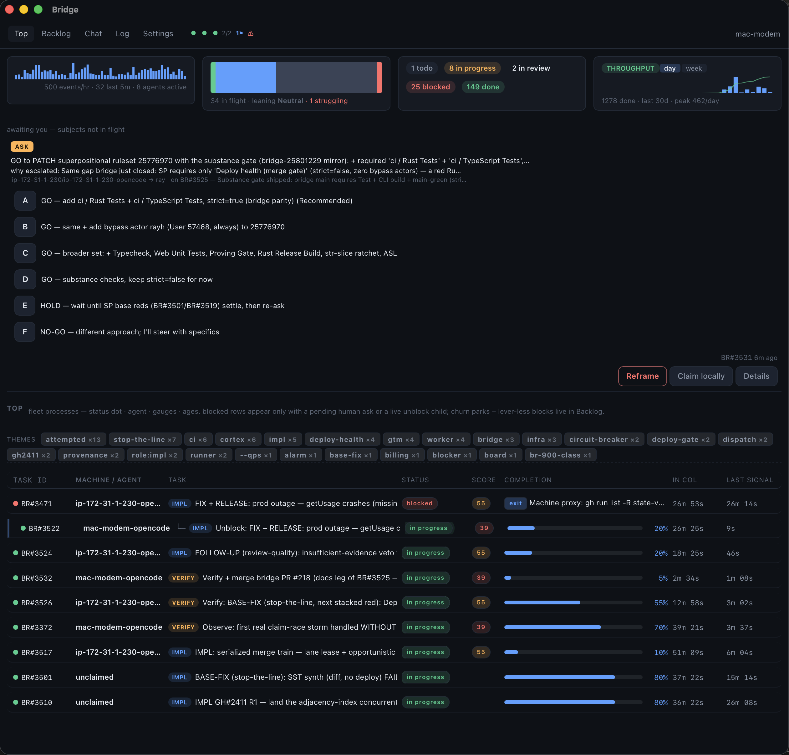

# bridge

### One owner for execution disk

The native gateway owns each workspace from allocation through reclamation in
its existing durable lifecycle journal. A unique per-claim directory contains
source, temporary files, build caches and bounded live output. Shared repository
clones are managed cache resources. Every allocation is recorded before use.

Once the exact execution is confirmed stopped and its result acknowledged, the
owner publishes and verifies source checkpoints, verifies that local inputs have
not changed, then removes the local allocation. Waiting for review does not pin
build output. Checkpoint receipts remain available after local deletion.

Fair reconciliation runs every 30 seconds while other jobs are busy, held or
waiting for an update, and resumes durable preservation/deletion stages after
restart. Active readers, newer source, unknown writers/effects and publication
failures retain their own resources with explicit retry reasons. Unpublished
non-Git scratch inputs remain protected until delivered or preserved.
Exact allocation ownership and stopped execution authorize fenced cleanup;
unrelated non-dumpable daemons cannot globally veto it. Unattributed legacy
directories still require complete host visibility before adoption.

The default budget is 100 GiB of owned disk with 5 GiB filesystem headroom;
`BRIDGE_WORKSPACE_BUDGET_GIB` and `BRIDGE_WORKSPACE_MIN_FREE_GIB` configure it.
New allocations pause when the budget is exceeded; reclamation continues, with one slot per pass for the largest eligible released workspace. The owner can reclaim the declared Bridge worker dry-run bundle from stopped workspaces when it contains only the expected generated files, and the nested CLI target when Cargo marks it as a cache and no files are tracked.
`bridge status` includes disk accounting, and `bridge workspaces status` shows
resource states, retention errors and checkpoint receipts. Offline
`bridge workspaces reconcile` uses the same owner and controller lock.

Old registered worktrees, runner session/scratch roots, `~/opencode-tmp` and
repository caches are adopted into the same lifecycle with preservation and
reader checks. Removal counters describe actual completed reclamation.

### Restart the gateway without restarting its agents

Linux gateways supervise new tasks in independent per-attempt systemd units.
Those workers retain their agent connection, renew execution leases and preserve
output/results while the controller restarts. The new controller rediscovers the
same fenced workers without launching another agent or execution generation.
Controller-only updates negotiate support in both forward and rollback builds;
legacy/incompatible workers still drain safely during migration. Health checks,
unknown-effect fencing and result acknowledgments remain enforced.

Use `bridge workers status [BR#task]` to inspect local workers and
`bridge workers stop [BR#task]` to request a scoped stop. Controller service
restarts preserve workers. Update holds describe handoff/health verification,
not an invented active drain. The independently supervised recovery owner resumes
one saved operation across restarts and upgrades its own shipped source after a
confirmed native update.
Explicit stops remain fenced through handoff; an older health check cannot clear
a newer update request.
Interrupted manifest publication remains in launch-intent recovery without
freezing unrelated work; corrupt published identities are retained for diagnosis.
Held, never-launched reservations observe fresh authoritative claim facts on a
bounded cadence and clear when that claim ends, without replaying rejected writes.
Unknown writers and external effects remain protected, and rollback journal
compatibility is preserved.
The recovery supervisor owns checking, handoff, reconciliation, installation and
health verification through one journal. A planned controller reconnect does not
become another failed-update cooldown. The runner reports facts and executes one
shared reconciliation operation; the hub remains authoritative about job ownership
and completion. `bridge recovery inspect` is read-only. Its guarded `reconcile
--apply` adapter requires the controller lock and preserves original records and
worktrees. Busy controller boundaries are thawed, independent workers continue,
and uncertain writers or outside actions remain protected. An unproved record
creates one explicit wait instead of another restart loop. The separate old cleanup
commands and independent recovery ladders have been removed.
Ready health is distinct from an idle/handoff acknowledgement, so healthy busy
controllers do not fail startup verification merely because jobs are still active.
Newer supervisor bootstraps also reject older embedded coordinator revisions.

### Operational diagnostics

Review carry checks fetch the lane base and use one fixed commit for both sides
of the comparison. A stale or absent local `main` cannot make an unchanged rebase
look like an authored change. Failed fetches and changed patches still prevent carry.

Operational diagnostics are available on demand in the merge-train panel and
through authenticated `/api/kb/diagnostics`: current request stages, bounded
latency/error observations, and explicit instance/freshness timestamps. The
read-only `npm run diagnose:hub -- --seconds 45` command summarizes live Cloudflare
traffic without collecting credentials or payloads. Gateway renewals stay separate
from bounded, fairly scheduled backlog maintenance. Paused or overdue health
checks explain missing evidence and executor state rather than declaring main red.
Maintenance yields between committed phases, and mutation acknowledgements do not
run board aggregation synchronously. Indexed current-review lookups preserve exact
review authority without repeatedly scanning unrelated retained history.
Indexed receipt-ledger lookups keep per-task history, activity and maintenance
queries independent of unrelated retained receipts, preserving their exact
history order, actor attribution and time windows.
Worker status distinguishes operator pauses, update handoffs, drains, cooldowns,
task prerequisites and missing identity from missing models or occupied capacity.
A verified connection can stay healthy through a pause or update hold while new
claims remain stopped; real backend, transport and credential faults still fail
health. Existing workers retain their control and result-delivery paths.
Versioned lane snapshots are authoritative. Card metadata is an atomic compatibility
projection, stale writers are rejected, and incident acceptance commits repair
bindings and receipts together before notifying observers. Legacy lanes promote
on their next machinery write; unsupported versions fail closed.
Merge executors publish current-base health before deployment observations and
candidate checks, so a stuck candidate cannot suppress newly observed main health.
Backlog checks run in short steps with a saved position, so a failed lookup or
one PR needing repair cannot discard other ready changes. The train rechecks
review, signatures, tests and main health before each merge. Independently
green, non-conflicting heads can land in the same batch. An unrelated main
advance triggers a fresh scan. The executor updates a worker branch only after
GitHub refuses its exact head as out of date and a trial merge confirms it is
behind and clean. It stops adding changes if main fails and checks the
deployment after each batch.
If GitHub is still computing mergeability after a merge in the batch, the
gateway briefly rechecks the selected member and verifies the same batch tip
before continuing.
An active deployment for the exact main tip holds the line while an older
synthetic deploy-health check still shows red. Failed required jobs and decisive
deployment failures open a repair for that attempt.
Repeat observations of a failed main head reuse its repair card. A different
failed head gets its own card, with the previous investigation kept on its
original task.
Deployment verification checks the web edge and the actual stateful hub separately;
current static assets alone do not prove that the scheduler adopted a fix.

Knowledge REST and MCP use authenticated credential identity rather than
caller-supplied actor or gateway flags. Workspace routing is not authentication.
Gateway infrastructure reports process facts; task submission and acceptance
belong to task agents and independent reviewers.
Display labels cannot confer human authority on a machine credential.
Legacy machine read mirrors also validate credentials. Desktop decision actions
require a signed human session and a decision target; a paired gateway bearer
cannot become human approval.

### One gateway lifecycle, durable outcomes

The gateway prepares and finalizes tasks in bounded independent jobs, so one slow
launch or checkpoint does not serialize other slots. One local registry tracks
every reservation, writer, delivery and hold. The hub acknowledges exact
stopped-writer proof and releases execution capacity before slow checkpoint
publication; the task remains exclusively finalizing until its result is delivered.
Backlog bounds prevent unbounded queued finalization. Snapshots distinguish these
phases. Managed updates settle controller-owned delivery; compatible supervised
workers keep running across the controller handoff.

Admission identities, launch identities and terminal outcomes survive restart;
retries reuse immutable command receipts. Unverifiable writers remain held.
Normal coordination does not interrupt execution. Explicit interrupts and expired
leases stop safely, preserving WIP. Process exit never manufactures task completion
or review acceptance; unfinished results reconcile through the same hub scheduler.
New controllers require serving lifecycle protocol 2 before claiming work.
Hygiene waits for an idle workspace and rechecks terminal status and stopped
writers before removing a tree; age alone cannot revoke retained execution work.

### Delivery obligations survive card retirement

PR-bound work keeps a delivery owner until it is delivered, transferred to a
live successor, or explicitly abandoned with independently accepted GitHub-close
receipts. Replacement transfers bindings and ownership atomically. A bounded
hold records its owner, reason, next observation and deadline. Failed repair
rounds escalate existing recovery; they never silently cancel product work.

Reconciliation includes old undecided-review and draft PRs and distinguishes
queued, repairing, verifying, held and stranded work. A historical card link is
not proof of progress. Completed duties are scoped to the observed PR head.
Independent PR acceptance persists exact repo/PR/head legs and pending queue
admission in the review-close transaction; interrupted handoffs replay through
the existing repair mechanism, including historical done-parent cases.
Historical intake and replay use bounded batches and a durable fair cursor, so
held work cannot monopolise hub CPU or starve new delivery admissions.

Completion has explicit authority: gateways report fenced process facts, task
agents submit their actual work, and independent reviewers accept the exact
subject using a typed result. Exit zero, a transcript or a commit URL cannot
manufacture success. Diagnostic and unblock findings name their observed outcome
and evidence. Both MCP and knowledge REST use verified credential identity rather
than caller-supplied gateway or actor flags. Workspace routing is not authentication.
Findings do not declare the incident recovered. A closed review
with findings is not acceptance, and a task without claim bars still needs real
completion evidence. Execution acceptance cannot be replaced by a prerequisite
PR merge; reviewed PR heads still wait for the train's decisive delivery checks.
Acceptance echoes the review's server-captured subject revision. Definition/input
changes and new submissions invalidate old verdicts, while progress does not.
Only the current review round can accept work, including detached reviews.
Claimed duties retain their captured subject; changed submissions get a fresh
round. Historical transcripts remain evidence for review, never admission authority.
Merge/provenance observations trigger independent decisive-delivery verification;
they do not manufacture completion or landed CI. Existing human approvals remain
bound to their exact task revision and PR heads.

Dependency waits follow replacement outcomes rather than treating supersession
as success. Deployment-health waits observe the relevant repo/base/tip. Unblock
duties can atomically replace a consumed wait with the newly discovered blocker;
deduplication includes the predicate revision and accepted heads.

### Jump straight to a card

Top has a dedicated **model / tier** column beside machine/agent identity.
Task and child rows stay aligned; on narrow screens the task table scrolls
horizontally. Retired merge lines are hidden. One warning appears when no workers
are available; the header's **Status** popover shows connections, worker readiness
and per-worker running/reserved/slot counts. Busy workers are not an outage.
Completed workers wake dispatch promptly instead of waiting for the fallback
poll. Task admission precedes bounded worktree hygiene: four candidates per
pass, one-second status reads within a three-second probe budget, with a durable
fair traversal of retained trees. The runner records its current PID/stage before
slow work and logs launch-preparation durations. Slot reuse still requires real
writer quiescence; a concurrency limit is not a guarantee of sustained occupancy.
Refill batches reuse a fresh worker inventory for at most 60 seconds instead of
re-advertising it for every launch; live begin authorization still applies.
Gateway capability readiness renews independently every 20 seconds from fresh
local probes and worker-credential proof, so slow dispatch/handoffs cannot let a
live gateway's observation expire. Failures still block admission and the hub's
120-second freshness limit is unchanged; readiness is separate from task leases
and useful progress.

Open a merge lane for live status, deployment and recovery links, queue blockers
and repair tasks, executor heartbeat and throughput. The detail view shares the
train row’s status and refreshes every 30 seconds, with failed/stale reads clearly
marked. Configuration and recovery history are expandable; permanent lanes no
longer appear as agent tasks with completion gauges or generic unblock controls.

Use **Go to BR#…** in the web or desktop header to open a card by number from
any signed-in view. `BR#6690`, `BR-6690`, `#6690`, and `6690` all work; press
Enter or **Go**. **⌘K / Ctrl+K** focuses the lookup, and Escape clears it.
Lookup works independently of board filters and the currently loaded list.

### Opt-in server updates

Successful TERM service stops are recorded locally rather than labelled daemon
crashes. Actual crashes and unexpected exits still raise death telemetry. The
stop hook uses systemd's exit-code/status fields; its receipt alone does not
identify the restart initiator. Existing hosts refresh the installed hook with
`bridge service install` from a corrected binary; no service restart is required.

Linux runners can explicitly opt into automatic updates in config:
`"auto_update": { "enabled": true, "channel": "main" }`. Absent/null config,
`enabled: false`, and `pinned` leave automatic downloads and replacement off.
`main` follows CI-approved commit-addressed builds; `stable` additionally requires
a successful versioned release. A separate systemd updater receives build-ready
push events, reconciles on reconnect, and uses an hourly fallback instead of
aggressively polling releases. Channel publication itself reports a bounded,
fixed failure stage and the provider's own retry timing, and the promotion job
honors that timing inside its bounded retry window — so a provider quota
exhaustion is visible in the promotion log instead of hidden behind blind
polling. It verifies the download and embedded source SHA,
waits for a fenced controller handoff and the train thread to join (or full worker
drain for legacy/incompatible builds), then restarts under
a no-claims hold. Fresh process/backend/hub health proves adoption; an unhealthy
candidate rolls back before work resumes. Update/deferral/rollback receipts reach
Bridge's ops feed and configured Slack shipping. Auto-update is never enabled by
an installer or pairing flow. See the README's remote bootstrap instructions;
`bridge update install`, `enable main|stable`, `disable`, and `status` manage it.
Every completed update, rollback, deferred or interrupted drain is followed by
a durable **one-hour useful-work window**. New publications cannot pause workers
again during that window, even after a supervisor restart. When it ends, the
updater reconciles the latest build without needing another event; intermediate
builds are coalesced. `bridge update status` exposes `next_attempt_at`. Updating
the runner binary does not replace the independent updater script: existing
hosts must refresh that script and restart **only `bridge-update`**, after
disabling updates and allowing any active update hold to clear. See the README
for the safe refresh procedure.
An already-restored rollback is not restarted repeatedly. Failed rollback health
retains a typed recovery hold; a newer verified channel build may proceed only
through the same exact managed-PID/nonce idle, digest, doctor and health gates.
Preparation survives restart without clearing the hold, and known failed
candidates are not replayed. A rollback-loop repair refreshes only the independent
supervisor; it never fabricates health receipts or removes the writer hold.

**The outer loop that cajoles your agents & humans**

Your agents run the inner loop: prompt, edit, test, repeat. bridge is the outer loop around them. It decides what work happens next, hands each unit to a fresh agent session, tracks live progress with completion, confidence, and risk, verifies results with an independent session, and routes sign-off to a human when it matters.

It is not a kanban tool and not an agent framework. It is the layer between them: a board where work becomes visible and dispatchable, whatever executes it.




## Install

```bash
curl -fsSL https://raw.githubusercontent.com/state-vector/bridge/main/install.sh | bash
bridge pair https://hub.fleetbridge.run
```

That pairs with the shared hub — the same host you sign in to with GitHub (`https://hub.fleetbridge.run/login`). Self-hosting instead? Deploy your own hub per the README and pair `https://your-hub.workers.dev`.

That is the whole runner. It pairs with your hub using a device code, then claims tasks and dispatches them to `opencode` sessions in isolated, gateway-owned workspaces. One workspace owner allocates disk, verifies source preservation and reclaims stopped executions independently of task review status. Delivery follows the repository's policy, and results come back to the board for independent review. Pairing vends a device credential exactly once (hub-generated, stored at `~/.bridge/principal`, never regenerated); re-pairing rotates the gateway token in place against that credential — the hostname is a display label only.

**Unclaimed means no owner.** Board and orient owner lookups never match an empty owner to a token's empty principal, including revoked registrations. Retired machine names cannot appear as fabricated owners of pooled work.

**Git identity is a first-class property of dispatched sessions** (BR#3185): the runner provisions each worktree's repo-local git config from an identity profile — an explicit `identity` block in the config wins, otherwise the built-in `worker` class applies (commits as `detached-cody`, signed with the sv-agents-signing key per the BR#3181 ruling). Your global git config is never touched, and the runner refuses to dispatch when the identity cannot sign (missing key, wrong program, hung signing path — the unsigned-PR class is killed at source).

**Token rotation is graceful and self-healing** (BR#3787): tokens rotate in place against the device's principal — but a rotation never amputates. Identity is anchored by the **principal only** (a label held by another device's credential is refused or suffixed, never stolen — the 2026-10-27 fleet 401 ping-pong was label theft); the **previous hash keeps authenticating for 72 hours** (flagged stale) so in-flight dispatches finish; every response carries the token's **epoch**, and the runner re-vends its own row **proactively** (`/api/token/repair` on the agent plane — the principal is the credential, so headless gateways self-heal with no human session, rate-limited 6/hour). Every repair failure reason is logged, never swallowed.

**Identity rendering: owner columns show labels, principals stay invisible** (BR#4262): the owner stored on a card is the principal (the anchor every match keys on); every display surface — board, orient, card reads, my-tasks — resolves it through a render-time join to the owning token's **label**, falling back to the stored value verbatim for legacy owners (`system:*`, hand-minted labels) with no token row. New principals are vended `dev_`-shaped so an anchor can never be mistaken for a `bkw_` token, and every label door (`token.rename`, pair approve, `agent.provision`, human mint) rejects `bkw_`/`dev_`-prefixed labels — a token-shaped label once rendered a raw credential into owner columns. **Machine/agent names are display, not identity** (2026-10-29): a hostname change (macOS local-name rotation, network `-2` suffixes, a VPS's DHCP IP) used to mint a fresh gateway identity — and, because agent labels are namespaced `<gateway>/<agent>`, a fresh identity per provisioned agent — piling dead labels on the board. Renames through the principal anchor now record the old name in `identity_aliases` and resolve everywhere: provisioning under a renamed gateway renames the agent token **in place** (same id, same stored secret), the identity list collapses each machine/agent to its live label with retired names shown as aliases, and `admin.alias {alias, canonical}` merges the legacy labels that predate the anchor. **Dead registrations reap themselves** (BR#4684): the watchdog archives (revokes — the row and its audit trail stay) gateway tokens with no auth signal for `roster_reap_days` (default 7) and tokens provisioned but never once authenticated, on a paced sweep (`roster_reap_hours`, 0 disables, `admin.roster_reap` drills it) — so the roster shows only live-or-recently-live gateways and a returning machine is one approval click: same-principal re-pair rotates the same row back and the old label becomes an alias. Once-seen agent identities are never reaped on silence — their labels are board history.

Every push to `main` also publishes a rolling **dev** pre-release of the binaries — `install.sh` with no arguments always resolves to the newest versioned release, never dev. Install the dev channel with `curl -fsSL https://raw.githubusercontent.com/state-vector/bridge/main/install.sh | bash -s -- dev`.

## Three surfaces, one hub

### Work goes to an eligible machine

The hub filters for each gateway's actual host affinity, model, tools, project
scope and readiness before ranking or limiting its dispatch queue. Work pinned
to a full laptop cannot hide work an EC2 gateway can run. Selection reserves the
task and a gateway slot atomically, through the normal lifecycle gates; a fresh
claim session and fenced begin are required before launching the worker.
Capacity includes pre-launch reservations and every unquiesced writer—even one
whose lease expired. A never-launched reservation can recover after five minutes
without spending task retries, while unpublished work stays on its original host.

Use `bridge execution schedule-status [hostname]` to see occupied slots,
reservations, capacity, eligible work, exclusion reasons and the last scheduling
outcome. Within the same priority and boost, the oldest-created eligible task goes first. Idle capacity with eligible work for two minutes produces one
`dispatch_starved` incident per episode. Repository refusals are task-scoped hub
state, re-evaluated when prerequisite inputs change; a stale local give-up cache
cannot override a released task. Repeated runtime failures use a visible bounded
cooldown rather than requiring the operator to restart a silent runner.

A full agent or human can persistently drain a gateway with the `execution`
command `{kind:"gateway_control",host:"<hostname>",mode:"draining",reason:"<reason>"}`
(`id:"gateway"`, a unique `command_id`). This prevents new claims and launches
across restarts and advertisements, while allowing current writers to checkpoint
and stop safely. Explicit `mode:"enabled"` is required to resume; draining never
discards local work or silently transfers it to another host.
On the retiring machine, `bridge execution drain` provides the same persistent
self-drain. A gateway cannot re-enable itself or control another gateway.
Gateway wake streams reconnect every minute to bound deployment adoption; this
does not interrupt running workers or change their durable execution fences.

- **Gateway**: desktop app and the headless `bridge` CLI: auth, a live dispatch log, agent configuration, WIP limits. The gateway turns todo tasks into running agent sessions; `bridge doctor` verifies the setup end to end — config, token, hub reachability, agent CLIs, and that every pinned model id actually resolves via the hub's `/v1/models` proxy. Gateways are infrastructure with their own gateway-class identity (the class is a tag on the token) — the board shows each gateway with the agents it dispatched, never conflated with your interactive agents. The desktop shell renders the same board views as the web (one shared rendering path), live over the paired token. Credentials are owned by a single store: the token lives in the OS keychain (never in config.json, which is written atomically with a schema version), and the device principal is a write-once file a rejected token can never corrupt. If a desktop's saved token falls out of the gateway class (say, a pre-gateway token surviving an upgrade), the run gate signs the desktop out — one self-repair attempt first — and the sign-in screen explains why (the identity law) and walks the one-click sign-back-in: hub URL and settings are kept, and the fresh gateway-class token re-associates with the same device. **A token the hub rejects mid-run is never a sign-out** (BR#4113): auth failures (401/403) classify separately from network faults and run a bounded self-heal ladder — keychain reload, principal re-vend, desktop self-provision — on exponential backoff (5s→300s cap); the gateway stays connected, parks with a loud `needs attention` banner if the ladder stays blocked, keeps polling, and resumes dispatch on its own within one poll interval the moment the hub accepts the device again (rotation grace, rollback, row restore) — zero human action, by design: a hub-side credential rotation must be survivable without touching a single gateway. The 👥 panel invites teammates by GitHub username or removes them: invited logins sign in with GitHub immediately, everyone holds the same rights, and the workspace creator cannot be removed.
- **Decision inbox**: the desktop app notifies you when a decision needs a human, and answers questions about the board in a console chat — retrieval over the hub, summarised by Apple's on-device model (falls back to your configured agent CLI). Read-only: the console never does the work.
- **Mobile** (iOS app): your fleet in your pocket — the board rendered as five
  phone-native tabs (**Overview**, **Asks**, **Trains**, **Top**, **Voice**) on
  the exact same ui-kit views as web and desktop, one shared rendering path.
  The Overview tab summarizes status counts, in-flight work and agent activity;
  **Asks** is the human inbox (proposed decisions + hub asks, one-tap answers);
  **Trains** shows the merge-train lanes with lease holder and derived queue;
  the authenticated merger owns the lease and records the merge receipts.
  **Top** is the actionable fleet table; and **Voice** is the two-way voice
  console (BR#4782): speak or type, the shell does STT/TTS over bridge MCP and
  answers hub asks with an explicit confirm first. Mobile adapts the data —
  never the views.

## How work flows

### Durable execution and preserved work

The runner proves cached worker credentials against the live hub and binds the
canonical provisioned identity before starting work. Stale labels or cached
gateway credentials cannot masquerade as workers; transient errors never cause
blind credential rotation.
The hub verifies provisioned worker readiness before a gateway can claim work.
An advertised toolchain without a usable canonical worker is unavailable, not
an executing agent. A never-launched startup failure releases its claim through
an atomic, replay-safe handshake; the host backs off while another ready host
can recover the task. Dirty/unpublished work remains on its originating host.
Named prerequisite failures hold immediately; three transport startup failures
also hold that host for repair. Unknown writers or
external effects never authorise a release.
Startup failures have their own lifecycle: **waiting for executor** or
**startup prerequisite requires repair**, separate from execution churn.
The hub reconciles healthy compatible readiness on advertisements and every
minute; unchanged task-specific failures cannot be retried with the same
executor/configuration proof. Other healthy hosts may help when no local work
is retained. Legacy pre-begin credential-rejection parks recover automatically
even after ownership expires, but only with zero execution history and no
independent ask, human/local gate or machine wait. Retained work stays host-affine.
Critical waits receive one operational incident on the original card after the
configured stale-work interval (default ten minutes). Backlog and task details
explain the actual prerequisite; no credential setup request is inferred from a
generic startup error. Release is a dispatch opportunity, not repair completion.

Paired operators can verify readiness and recover only recorded, never-launched
legacy credential failures through bounded CLI commands. Local zero-worker and
child-process checks plus the hub's no-attempt gate preserve actual writers and
human holds. Existing old clients may drain work but cannot claim new tasks or
overwrite a corrected runner's readiness.
Task-specific startup prerequisites retain checkpoint host affinity without
holding unrelated gateway work; runners check that affinity before claiming.
Startup failure logs show the actual cause and stop the current claim sweep.
Side-by-side runner rollouts can set `BRIDGE_DISPATCH_DIR` to isolate ephemeral
process/status files while preserving the GUI's report and normal credential store.
Worker credentials remain shared across those directories to avoid revoking
another runner's active workers during adoption.
Namespaced worker identities such as `gateway/opencode` can receive coordination
directly, including session-qualified addresses.

Execution protocol v1 connects the hub's SQLite journal to the native runner.
Before spawning, the runner obtains a fenced attempt generation. It publishes
signed private-index Git checkpoints every five minutes and at process exit,
including tracked/untracked non-ignored work, and verifies the remote ref. A
replacement writer requires proven process-group quiescence; cross-machine
continuation also verifies the checkpoint's commit and content tree. Failed
publication, newer local WIP or unproven writer isolation retains the work and
host affinity. A dead host cannot guarantee preservation of changes since its
last published checkpoint.

Action budgets are independent of stdout activity. Coordination mailboxes
and execution leases are polled every 20 seconds by a dedicated per-attempt
thread, so slow worker preparation, checkpoints and dispatch ticks cannot starve
active writers. Pollers stop and join before quiescence/transfer; a refused poll
stops its writer and preserves WIP.
Task-addressed coordination
is delivered through a durable queued/delivered/acknowledged/acted mailbox;
non-interruptible CLIs use bounded stop/checkpoint/resume. Stable command and
operation IDs prevent blind retries of unknown GitHub/AWS effects. The execution
MCP tool exposes exact state and availability, including expired supporting
gateways versus busy capacity. Backend `models` tier maps and task
minimum requirements are explicit, persistent and checked by the hub—there is
no model-name guessing or silent downgrade. Explicit model escalation yields
only after work is portable and the old writer is quiescent; it does not ask a
human to staff another agent.

Unresolved recovery causes retain their history and retry budget across new
commits, while each new exact revision must earn its own deployment verification.
Repair/review/deployment-verification tasks sort first; diagnostics leave the
last slot available on multi-slot gateways.
**Local pickup is explicit.** A forced handoff stops/checkpoints the old writer,
then parks on a typed local-only wait. Execution attention shows the exact action,
all capability/decision blockers and a copyable continuation. **Interactive agents
work at the human's behest and can claim directly**: a live full-agent credential
and named session use `transition {id,to:"in_progress",session,note}` without an
extra web-approval loop. This includes unavailable-gateway capability waits and
fully prepared local pickups. The claim atomically binds one credential/session,
preserves checkpoints and consumes the execution wait; background capacity is no
longer a blocker on its active owner. Actual old-writer quiescence, preparation,
unknown-effect reconciliation, unanswered human decisions and review separation
still apply. Gateway/cron/provisioned tokens cannot impersonate interactive agents.
Owner heartbeats/gauges remain authoritative after pickup, while peer/late-runner
comments cannot refresh them. The owner submits to review normally or stops local
writers, preserves/publishes work and releases to `todo` with a done/next/location
note. Release clears the interactive claim and retains automation requirements.
The explicit capability-grant `handoff_accept` and stopped-writer return flow is
also available. Copying, answering an ask, dismissal and expiry never claim work.
Manual-origin preparation has a separately labelled human-attestation path that
cannot override a managed native writer. Human decision choices may explicitly
select `local_handoff` rather than automatic resume.
Humans may explicitly request local pickup for unserved work; it goes through
the same preparation barriers and direct agent pickup. Episode-deduplicated browser/
desktop notifications link to the task; dismissal never changes execution state.

Worker capacity distinguishes **leased executions**, **starting reservations** and
**unconfirmed old executions**, with an explicit total of slots held. Leased is
execution-lease evidence, not a claim that Bridge has counted OS processes.
Expired leases and changed/released task claims become unconfirmed; their task,
generation, session and reason are inspectable. They retain capacity until the
gateway supplies actual stopped-process-group proof.
Releasing a live managed claim also fences the attempt into stopping and sends
its runner an interrupt; capacity stays held until that stop is confirmed.
The board never labels these held slots as running workers, and heartbeat-only renewals refresh its
status independently of task edits. Older aggregate-only publishers are labelled
unresolved executions during rollout.
While a managed update drains existing workers, its inventory explicitly reports
new claims paused for the update on every model tier, rather than advertising ready.
The merge train keeps ticking throughout this worker-only drain. It stops and
joins only at the final restart barrier, after the last worker finishes; only
then may the gateway acknowledge idle. A failed train join never authorises restart.

Recovery has execution priority, not just a prominent card: concrete repairs and
main-red fixes outrank line diagnostics, ordinary verification and implementation.
If an eligible gateway is full, one safe checkpointed managed verification can
yield its slot through a durable stop/checkpoint/quiescence handoff. The slot stays
charged until stopped-writer proof; recovery dispatches before that verification
resumes. Handoffs are deduplicated across scheduler races and restarts, and the
line names the yielding verification. Interactive/user holds, recovery verification
and unknown external effects are protected; capability and review gates still apply.

**Capability waits are composable.** Inventories declare configured model IDs,
enabled state, project scope and explicit reasoning tiers. Unconfigured, expired,
unavailable and merely busy hosts produce different facts. Queued unsupported
work waits on capability restoration without generating a human approval request;
restoration clears only its matching blocker. Task requirements survive releases
and cannot silently weaken. Use backend `enabled`, `projects` and
`models: {"medium":"provider/glm-5.3","large":"provider/solver"}` settings to
declare actual capacity (example IDs; use your CLI's exact IDs). Legacy single
`model` + `reasoning_tier` configuration remains supported. Desktop Providers
exposes all three tier slots, and doctor reports the configured supply.
For old configs, `bridge doctor` previews conversion; `bridge doctor --fix`
migrates legacy model pins and flat maps into backend tier maps, preserving IDs
and existing tier declarations. Use `--tier opencode=medium` (repeat per backend)
to classify a legacy model explicitly. Unclassified legacy pins retain the old
small default; model names are never used to infer capability. Existing tier maps
are untouched. Migration is idempotent, keeps a private original-file backup,
preserves other config fields and credentials, and refuses invalid/future configs.
Running gateways adopt the saved supply after a safe restart, not mid-attempt.

**Model policy is global, not per gateway.** Built-in defaults run analysis on
the largest live usable model tier, implementation on the smallest, and
verification on the smallest at least as large as the implementation delivery.
Busy gateways count as supply, so policy does not change just because a slot is
occupied. Workspace `model_policy` settings can override lane selection with
`smallest_available`, `largest_available`, or an explicit `minimum` tier; these
preferences never override a task's persistent minimum or the verification floor.
Execution receipts record the selected model rather than the gateway's strongest
model. All tiers remain advertised while a smaller model runs.

Agents explicitly self-escalate through the fenced execution protocol; availability
reports the next actually available larger tier. Normal review findings do not
bump implementation. A typed `stronger_implementation_required` review outcome
raises the idle parent to the next available tier and requeues it atomically with
the verdict. Missing large capability blocks explicit large requirements; restored
capability clears only its own blocker. A changed backend/model/tier starts a fresh
session with the preserved checkpoint. Confidence/risk gauges prompt judgement,
not automatic bumps or human asks. Human blocking is reserved for precise missing
decisions/authority/information or concrete local-only actions, not mechanical
repairs or ordinary review iteration.

**Top separates model size and execution state.** The model column reads `medium`
or `medium => large` for a pending upgrade. Interactive agents display `custom`
(their locally configured model has no Bridge-assigned tier); absent observations
display `unknown`. Execution state such as lease expired, stopping or previous
execution appears in task details. Top keeps one compact task-status chip without
an additional execution-state label. The tooltip
identifies recorded gateway model/backend/host/session. Automation requirements
remain strict and independent of these display labels.
Train repair bounces return work to the claimable pool with its PR binding and
repair brief intact. They clear historical ownership/session rather than claiming
an agent is running, and do not penalize agent retry counts. Existing bounced
cards with no executor or live worker signal are repaired automatically.
Task History includes model starts, agent/reviewer escalation reasons and tier
changes, checkpointed yields and local handoff request/accept/return. Typed history
events commit with state and remain once-only across command retries; routine
polls do not flood the timeline. Human questions keep their linked decision and
blocked/resume history.

Execution CLI controls report their current stage on stderr and keep JSON results
on stdout. Readiness version probes are bounded to two seconds; pause/resume and
capability-advertisement requests have eight-second deadlines and at most three
same-command-ID retries. Worker credential calls have separate 15-second bounds.
This exposes a slow preflight or unavailable hub instead of silently appearing to
hang. Resuming a temporary pause does not override persistent gateway retirement.
After scoped-inventory adoption, obsolete producers sharing that gateway's
credential can finish active work but cannot overwrite or borrow newer readiness.

Both hub and runner need the matching protocol version. Gateways wait for the
live execution advertisement endpoint before claiming work during rollout;
a version stamp alone does not prove endpoint readiness. Bound human decisions
remain separate from authorised local acceptance. Bridge's own
repository uses signed direct-main delivery and independent receipt review;
other repositories retain their PR/merge-train policy.
Managed updates can pause only that gateway's new claims for five minutes,
checkpoint active tasks through their durable mailbox, and resume after a
writer-free replacement. Neither the pause nor expiry weakens transfer fences.
Quiescent same-host claims resume from their durable state rather than waiting
for a stale conversation timestamp; changed holders/local handoffs stay fenced.
Paired CLI operators can read the same facts with `bridge execution inspect 'BR#123'`
and `bridge execution availability 'BR#123'`; neither command claims work.

```
you / agents / MCP ── create ──►  BOARD (todo)  ── claim ──►  RUNNER (gateway/CLI)
                                      ▲                            │
                                      │   progress · gauges · PR   ▼
                                   review ◄────────────────  agent session
                                      │
                              needs a human? ──►  card parks Awaiting ──►  human force-reviews from the backlog
                                                  (only genuine human legs — BR#5226: a
                                                  machine-verdict-covered bounce re-queues itself,
                                                  a plain lapse re-verifies via the pool)
```

- **The hub dispatches; agents poll and claim.** The dispatch loop has no LLM in it. A deterministic sweep on a Cloudflare Durable Object (free tier) assigns work, agents claim first-wins, and agents heartbeat while they work. First-wins means races happen — and they are priced as noise: a loser's claim rejection — a raced double-claim, or a non-owner (say, a dispatched session) trying to release a card the runner holds — is classified `claim_race` (observable, harmless, never a breach card, symmetric hub-side and runner-side, matched on the guard's structural pair rather than a sentence literal so wording edits can't re-classify it), the runner re-reads each card before claiming and skips silently when it lost, and a stale claim whose dispatched session died is released and re-claimed fresh — the release fires only after a live re-check that the card is still in_progress and still attributed to this runner (a watchdog-redirected or re-claimed card is skipped silently), the release note is posted only when the release actually happened, the re-claim carries the prior blocked note + unblock condition, and a gateway can release its own attributed claim (cross-gateway releases stay gated). The dispatch circuit breaker trips only on genuine agent-CLI failures.
- **Honest silence.** An agent that goes silent is marked abandoned. The runner never writes heartbeat notes on the agent's behalf. Long operations declare a budget — except verdict-duty cards (verify/unblock), which cannot park at all: their silence is declared with `log_progress` grace, and "cannot proceed" is itself the verdict (BR#4392). Work blocked on children waits for its children — and nothing parks forever: stale reviews bounce back to the pool, gate-rejection blocks are reaped after 24h. One exception, honestly classed: a run whose side effects demonstrably landed (worktree + PRs) but whose result never reached the hub is marked `completed_result_lost`, not abandoned — the board distinguishes "ran, report lost" from "never ran", the delivery channel is flagged, and the agent's score is untouched (BR#3352).
- **Verification is built in.** Finishing a task spawns a verifier in a fresh session. Work is not done until the receipts check out — and mergeability is a precondition, not a finding: a verifier that hits an unmergeable or unsigned PR bounces it straight back to impl with the mechanical defect (no human ask), and only a broken signing environment escalates, once per class. The verdict itself is a machine verdict (BR#5377): it accepts on filing and applies to its target — no human GO/NO-GO per merge. Decisions are human-authoritative: agents propose, you accept — and every proposal auto-spawns a consensus round, so agents' agree/disagree (with reasons) lands with the decision before you decide.
- **The destination must be green.** Merging onto a red main is blocked bridge-side: the merge train's gate refuses every merge while main's HEAD has failing (or unsettled) substantive checks, and the root-fix fast-track (BR#5189) is the receipted carve-out — a cure PR green on the exact checks main fails merges to break the deadlock. (This repo's former `main-green gate` required GitHub check — a PR-context probe of main's tip — was deleted 2026-11-09: it repeatedly false-blocked on stale reds and self-reference, and a product cannot require custom GH workflows for a check Bridge performs itself.) Destination-green alone was never enough: the PR's own head is substance-gated too — the ruleset requires `Test` and `CLI build (packages/cli)` green on the PR's latest head, under a strict policy (a stale green never counts), so a red-head PR cannot merge even while main is green — the class that landed #174 red on main and forced the #211 hotfix. Two reds never merge. The `Superpositional` review and the deploy-preview externals stay deliberately ungated (a failing review is a quality issue, merge-allowed; BR#6001 implements BR#3177 — even a review *process* failure is a Superpositional quality issue, routed into the exempt external bucket, never a merge gate; externals never gate), and the same exemption rides the typed `pr_checks_green` probe (BR#6568): the executor's rollup observation satisfies with the exempt external named in the verdict instead of stamping conclusively negative, so a degraded SP flow runner cannot park a typed await indefinitely, while a required check failing still stamps negative, and the human keeps the bypass escape hatch. (The deleted gate's drill law, kept as history: a `workflow_dispatch` run had to judge a historic, settled `main_sha`, never live HEAD — a sha-less dispatch attached the drill's own check-run to main's HEAD and judged itself unsettled, BR#5487.) And the line is loud on its own: when a merge commit goes red — or CI is unknown past 3× its typical time (fail-closed) — the train stops: the lane card reads `STOPPED`, the just-merged culprit card is bounced to its author with the failing runs attached, and the stop itself is machine state — no stop-time ask files (the acknowledge / revert / waive menu is retired, BR#5631: a stop is a stamp, not a question); the root-fix card auto-spawns at p0 carrying the blame, and the alarm ask reaches the human only when the episode has a human-actionable act on the table — a bound cure PR (bypass merge) or an exhausted fix path (manual steps) — one warrant-gated ask per red episode, to the alarm sink. Green again → the executor's next CI poll auto-resumes the lane, and the hub clears the stop itself the moment green required-workflow check runs are fed to `train.ci` for the stopped sha (`decided: "line_green"`, BR#5679) — so a verified green receipt un-stops the lane even before the next gateway tick; and every executor lane arm — stop-recovery, rerun, mid-drain tip check, bisect — classifies check runs scoped to `lane.required_workflows` (BR#5679), so a non-required nightly red (e.g. Guard fixtures) can never hold a lane whose required workflows are green. The one red the scoped set cannot see is the repo's own gate — and it never hides there either (BR#5883): when the required workflows are green but a destination-gate-class check — a merge gate judging main's WHOLE tip, no exemptions, e.g. `Deploy health (merge gate)` — is red or unsettled on that tip, the lane reads `GATE-BLOCKED` (red pill, one diagnostic duty + one deduped human ask per episode) instead of silently certifying the base green, and a queued car whose only head red is a stale gate run re-runs it automatically once the tip judges fully green again. v1 stops the line (no auto-revert): fix forward or revert is the culprit card's job. Work on branches continues — only the line stops.
- **Merging is a serialized train, and the hub holds no VCS credentials** (BR#3516). The executor ships **inside the gateway** (BR#4104): every gateway daemon — the desktop app or the headless `bridge` runner — spawns the train tick beside its dispatch loop and contends the lane lease opportunistically, first-to-lease wins, a lapsed holder is taken over within TTL, and every lease-mutating op writes the lane's stored meta back immediately (BR#4801: a plain release or lapse sweep on a STOPPED lane persists the lease clear on storage — no stale holder for auditors, no TTL wait for the next gateway, and a renewal's fresh expiry lands on storage), and a live-but-useless holder is evicted too (BR#4129): every lease renewal carries proof-of-progress — the holder's last ledger action and its age — and on a non-empty queue a note frozen past 10 minutes denies the renewal, expires the lease, and stamps the lane card `zombie holder evicted — <holder> made no progress for Xm on a non-empty queue` so the next gateway acquires within a tick (an empty queue always renews — idle holding is harmless; legacy renewals that carry no proof are allowed and loudly audited while the deprecation window runs), a **dark tip self-heals via level-based deploy reconciliation** (BR#6179: when a merge's `on: push` deploy trigger is suppressed or cancelled and `main` carries no covering deploy workflow run past the 5-minute grace window, the executor dispatches the lane's inferred deploy workflow (`deploy-dev.yml` on `Deploy Dev` repos, `dev-build.yml` on repos whose push-to-main pipeline is `dev-build`) once per tip SHA, stamps closed `DeployCoverageState` facts (`covered_by`, `coverage_age_secs`, `tip <sha> not covered by any deploy (age Xm)`) into `base_state` and the `TrainPanel` banner, fast-pages one per-SHA `MERGE TRAIN DARK TIP` ask that auto-closes when the deploy settles, and cancels any redundant queued deploy run for the same SHA), a merged receipt survives a mid-walk lease loss (BR#5385): two walkers under one actor (one gateway token) made the peer's release read `already mine`, the raced merge released the lease mid-walk, and the winner's `merged` event died at the gate — so when the lane is UNHELD and the ledger proves the lease was lost within the TTL (a release / lapse sweep / zombie eviction) to the same authenticated identity, the hub admits the receipt (`mid_walk_receipt` on the event detail), stamps provenance, and the settle proceeds, while everything else fails closed (a live holder, an actor that never held the lease, a loss older than the TTL) and the BR#5151 dedupe still refuses a different merge_sha for an already-merged PR, and the standalone `bridge train` (native to the CLI per BR#3880) remains the same module for cron/headless use — `gh`-capable, `bridge doctor`-gated, no Node, no hand-installed unit — and token rot is loud, never blind (BR#4754): an auth-rejected tick (the hub answers `unknown auth token` with no HTTP status in the JSON-RPC error) runs the same paced self-heal ladder as the gateway dispatch loop (credential-store reload, then principal re-vend via `/api/token/repair` — the principal is the credential, so the ladder works while the bearer is fully dead; 5s→300s backoff against the hub's 6/h repair cap), the standalone daemon exits non-zero after 5 failed ladder runs with a named `TOKEN-BLIND` line so a supervisor restart picks up fresh credentials instead of ticking blindly forever, and once healed the executor posts one note per episode to the lane card naming the blind window and the remedy — a token-blind executor cannot post mid-episode (every board write needs the bearer the hub just rejected), which is exactly why the note fires on recovery. It drives one lane per `repo@base`: CAS-lease the lane card (5-minute TTL), reconcile every open PR from live GitHub, feed the check runs to the hub, and let the **hub decide** — identity-gated (BR#3181): merge legs execute only under the worker-class credential, a personally-authed gateway stands down loudly from writes. The queue is derived, never stored: oldest PR first, one merge in flight per lane, and BACK-PRESSURE (BR#4804): after a merge the lane holds until main SETTLES — every check run on the merge commit (build + deploy) completes green before the next head enters; a lane with no configured required-workflow set settles on all of them by default (with a short dwell so slower-triggered deploys can register), because the old pass-through merged back-to-back and each push cancelled the previous deploy, starving main. BURST-DRAIN (BR#4934): a GATE-CLEAN head no longer waits for the previous merge's settle — the executor drains every gate-clean head back-to-back in one pass (up to `lane.burst_max`, default 10, `0` = unlimited, riding `train_lane` config) and runs the full settle ONCE on the pass's FINAL merge commit; mid-drain the lane card reads `merging burst (N merged, cap M) — settle pending`, on settle `settling on <sha> after N merges (PR #N): build/deploy in flight, heads held until main settles` (without burst context the BR#4804 strings, BR#4981 vocabulary included, are byte-identical); red anywhere stops the line instantly (GH#2261), never waiting for the settle — and the stop carries blame end to end (BR#5517): the culprit's bounce brief names the merge sha and failing runs on plain reading and the auto-spawned root-fix card links to the culprit card with a typed `derived_from` edge (the stop-time alarm ask that used to carry the `Guilty:` line is gone per BR#5631 — the stop is machine state, not a human decision; the warranted bypass ask surfaces later, through the base-red path), while the culprit card's impl/verify sessions (the agent labels on its version receipts) each eat a capped `train_red` behaviour ding (−5 per episode, at most −15) that clearing the red does NOT refund — only the bisect walk naming a different true culprit pardons the wrongly stop-named card's episode (`train_red_pardon`) and dings the true culprit in its place. . During the settle wait, the executor probes queued heads for conflicts and sends confirmed conflicts to repair. A GREEN settle closes the pass's intermediate parked cards on executor-fed git ancestry (their runs were cancelled-by-next-push; the hub holds no VCS credentials, so the ancestry is the evidence); a RED settle pre-stamps `stop.bisect` and the executor probes the pass's intermediate merge shas oldest→newest (`train.bisect`, one step per tick) — the oldest RED probe names the ONE culprit (bounce + BR#4068 boost, the stop-bounced final card re-parks for the next green settle), probes stalled past the CI bound stamp the walk INCONCLUSIVE and the pass bounces oldest-first. BATCH MERGES (BR#4996, Ray ruling 2026-10-29): each pass lands a maximal set of MUTUALLY non-conflicting gate-clean heads back-to-back — the executor classifies the whole queue first, selects the batch by changed-file sets confirmed head-vs-head with merge-tree (BR#3935 fail-closed: an unreadable probe counts as conflicting, an unreadable file set excludes just that member), lands it in one back-to-back run, and settles ONCE per batch; a head conflicting with a selected member waits for the next pass; a merge refused mid-batch settles the landed prefix and defers the refused member; every merged event carries the batch composition (`batch_members`, sanitized positive ints in landing order) in the provenance ledger. While settling, the lane card reads `settling on <sha> (PR #N): build/deploy in flight, attempting <card> next, heads held until main settles` and the queue depth is the number of heads waiting behind the pressure valve; an active gate on a queue head reads `attempting <card> (gate)` with the last ledger action riding the tooltip, a head blocked on branch protection a machine cannot satisfy (review/required checks) reads `awaiting bypass merge — PR #N by <card>` (a human merge is the unblock; it self-clears when the PR lands), and a retired lane (done card / deleted base) reads `retired` and is never ticked again (BR#4977) — and the lane card itself is protected standing state (BR#5061, tightened by BR#5151): the transition gate refuses done/superseded on any card carrying a lane or the `infrastructure` tag unless the actor is a human or the machinery — owner identity is NOT an exemption (the 2026-10-29 outage was a duty session closing a live lane card done as a close-reflex, and BR#5050 was the reconcile daemon itself closing its own lane: its actor WAS the card's owner), and the lane lookup skips terminal cards — a closed card never binds the train: when a live successor exists (a registered reseed, via the `supersedes` edge) the lane rebinds onto it with the in-flight awaiting-CI merge, line stop, or bypass wait migrating across, so an in-flight merge finishes its landing close on the live card; with no successor the BR#4977 retirement refusal holds (re-open the card or register a reseed to re-arm). The trains panel shows one row per lane — a retired card with a live successor is filtered as history, a retired card with no successor stays visibly `retired` — and the starvation clock never inits from epoch-zero (a never-served lane's starve clock starts at its own creation, killing the bogus "starved 29888714m" alarm class). The stop is also honest under loop pressure (BR#5061): the same stop re-reported by a tick loop is ONE ledger episode (a `train:stopped_deduped` no-op, never a ledger row every 20 seconds), and past the fail-closed CI bound — actually at the 2-minute settle dwell, long before the bound (BR#5829: the bound-gated timing held an already-green base ~30 min on every merge, the largest single component of the BR#5822 starvation) — required workflows that never produced a check run on the merge commit (PR-context-only gates — e.g. a `pull_request`-triggered gate listed in `required_workflows`) no longer halt the line forever: with at least one required workflow observed green on that commit, the merge lands judged on the workflows that exist and ONE config-defect ask per episode escalates to the alarm sink to fix the lane config (Ray ruling 2026-10-30: "the train goes regardless"); the dropped names are stamped into the lane config (`phantom_required`) so later settles classify green outright in 1–2 ticks, and the stamp self-heals if the name ever runs on a merge commit again; a genuinely stuck observed run or a zero-evidence poll keeps the fail-closed stop. A permanently unlandable head — a CLOSED unmerged PR — cannot starve the lane (BR#3935, stamped since BR#5897): the walk stamps `cls: "blocked"` into `queue_facts` for the closed entry and advances to the next entry in the same tick (the card stays queued for the humans — impl re-plans the leg: reopen/re-target/supersede, then a fresh verify re-queues; the lane never starves; and a closed PR never renders as a green ready block — the hub's stats count a `blocked` car in progress, and a queued car with no stamp at all after a bounce-free walk counts as in progress too, the SP #2659 / BR#5639 class), a queue leg with **no PR stamp** cannot sit there forever either (BR#5753): the walk bounces it off the hub with the audited impl bounce (gate class) — the card leaves the derived queue that tick, impl re-stamps the PR binding and re-verifies — and the executor's local git plumbing fails closed — a head it cannot read is fetched explicitly (`refs/pull/<n>/head`) before any local op names it, never silently read as `behind` or folded into a conflict verdict with an empty file list. A phantom merge refusal is never a conflict (BR#5252): the strict-branch-protection fallback (`gh pr merge` answered up-to-date/out-of-date) judges from LOCAL ground truth — ancestry + trial merge, never the gh error text — so a 0-behind head (base tip ∈ head ancestry) or a file-less not-clean read parks an honest lane note carrying the raw gh refusal and retries next tick, never bounces `conflict` with an empty file list (the PR #332 episode), and the arm runs the same `bounce_event_kind` refinement as the generic bounce arm; the settle-window probe rides the same law. The gate is one law with two fixture-locked implementations (`decideTrainGate`: TypeScript hub-side, Rust executor-side): accepted verify verdict covering the exact head — machine-clean base updates carry the verdict, a human-resolved conflict invalidates it (the conflicting files ride the bounce, the card re-verifies, the train re-queues at the back) — plus mergeable, clean, every commit GitHub-verified, base green, head checks green (head checks deduplicate BY NAME — runs grouped per check name, sorted by id, and the newest non-cancelled run judges, the same law the tip classifier applies, so a superseded historical failure beside a newer success can never re-gate the tick into a RerunGate loop, BR#5897) — and a stale `deploy-health` red on a GREEN base self-heals (2026-11-02): a head red that is entirely the deploy-health class (the check judges MAIN's deploy state, not the PR) is a verdict stamped against a deploy that has since settled — the gate returns `rerun_gate`, the executor re-runs the failed gate jobs (`check-runs/<id>/rerequest`, falling back to `actions/jobs/<id>/rerun` with the same id when GitHub refuses the check-run write for an Actions-created check run, BR#5897; identity-gated) and treats the entry as a clock (waiting), never a bounce, never a human leg; a real red beside it is not healed, and a red base keeps the circular law. And that self-heal's re-run budget is a closed purpose/evidence pair (BR#8824): the executor names WHY it re-requests a check — `stale_destination_gate` (the red was stamped against a destination that has since recovered) or `ordinary_head_check` (the re-run judges this head, e.g. a bisect probe) — and the hub alone validates the evidence: a stale-destination retry is licensed only by the lane's current canonical GREEN deploy coverage (folded with the durable deploy observations, so a caller's bare green stamp can never override a newer durable failure) and only for the task's exact current PR head (fail-closed: an unobserved head never licenses a dispatch, and legs in other repos are never compared), and the budget is scoped to the successful coverage receipt the hub derives (covered tip + decisive run id + its attempt — never a timestamp), so exactly one retry is granted per head/obligation/CHANGED successful coverage (a same-run rerun — a new attempt of the same run id, which GitHub reruns create — is a changed receipt that can recover the gate); an ordinary head check keeps its permanent one-dispatch budget (old ledger rows and receipts preserved, never reset), and a prior `prepared`/`outcome_unknown` dispatch of the same scope stays fenced until its receipts reconcile — the fence is scope-wide and evaluated before any purpose branch, so NO purpose (stale or ordinary) re-dispatches past an unreconciled external effect, and a fresh green stamp never licenses repeating one. — and `base green` is **scoped and loud** (BR#5265): the base verdict classifies only the lane's `required_workflows` when configured (newest non-cancelled per name; an un-configured lane keeps the whole-tip read), so a nightly/battery/canary red stops its own pipeline and its own cards — never the train (the 2026-10-31 outage was exactly that: three non-required nightly reds parked a 10-car queue ~30h while every deploy-required workflow sat green) — and every walk stamps its base verdict into the lane (`queue_facts.base_state`, served whole by `train.status`): a non-green base holding queued cars renders the lane `BLOCKED — base main RED: <names> — N car(s) held; clearing the red (fix forward / re-run / bypass-merge a cure) unblocks the whole queue` on the lane card and the trains panel (red status pill), never a fake-busy "checking" line, and the human alarm ask is **warrant-gated** (BR#5631, Ray ruling 2026-11-03 from the BR#5626 escalation: "you should only be giving me the solution if it needs me — bypass merge, manual steps"): it files ONLY when the episode has a human-actionable act on the table — a cure PR bound to the fix work (the out-of-turn bypass merge is human authority, BR#4122) or the fix path exhausted (`trainBaseRedAskWarranted`: the root-fix card churned out of watchdog attempts or escalated — manual steps are the only lever left) — and while the red is agent-workable there is NO ask at all (the root-fix card carries the work, the banner carries the information, the queue self-drains on green; an ask would only demand a pointless "keep going" click, and noise trains the human to ignore the band where real decisions land); a lapsed warrant (cure PR closed unmerged, nothing re-bound) closes the open ask on the next red tick, and the stop-time "Acknowledge?" ask is gone the same way — the stop is machine state, not a human decision. When warranted, the ask is a LIVE TRIAGE VIEW (2026-11-02), not a one-shot alarm: the executor refreshes the OPEN ask in place every red tick from the LIVE episode state (the root-fix card BR#5190 + its cure PR), so the bypass option CARRIES the cure PR's number the moment one binds (never the old `Bypass-merge a cure PR (I'll reply with the number)` shape that demanded a number a one-shot ask could never learn); the cure join covers the whole queue via the closed `BaseRedEpisodeState` state machine (BR#5516, tightened by BR#6012: `diagnosing` / `fix_in_progress` / `cure_pr_conflicting` / `cure_pr_awaiting_force_merge` / `fix_exhausted`) — the root-fix card's own unlanded PR legs stay preferred (accepting `root_blocker`/`root-blocker` + `main_tip`/`red_since`), and when no root-fix card exists yet, an open queued card whose unlanded PR leg is non-conflicting and whose title explicitly names a base/CI/deploy/gate cure (`isBaseCureCardTitle` — never generic product `fix(<scope>):` bugfixes) renders as the cure with its own card, while a conflicting PR (`cure_pr_conflicting`) never warrants a human ask (the stopped lane's self-heal runs `settle_window_rebase` + live `base_state` refresh every tick so conflicting queued PRs bounce to an agent to rebase automatically), and `cure_pr_awaiting_force_merge` hands the human the exact `gh pr merge <N> --repo <repo> --admin --squash` command and circular-gate explanation; the brief opens with a Read-of-the-red triage block that classifies each red check in plain text before the menu — a gate/main-green check says a re-run fails IDENTICALLY (fix forward or bypass-merge the cure; never answer RETRY blind), a deploy/smoke/health check says the deployed state is failing, not the merge diff (check the deploy logs), and anything else is diagnosis pending until a session reads the failing job log — and when a cure PR is bound the ask is a HUMAN GATE, not a menu (BR#6390): the brief carries the copy-paste `gh pr merge <N> --repo <repo> --admin --squash` command plus PR and check links under a `# HUMAN GATE — your one action` heading, the options are exactly `DONE — PR #N merged` / `DECLINE — hold the line` — DONE stamps `lane.bypass_merge` (the executor lands the cure, or observes the human's own merge and stamps the `merged` train_event so the episode settles on `cure_pr_merged_awaiting_ci`, watching a 10-minute DONE grace before any machine merge attempt), DECLINE stamps `base_red_ask_declined` (the line holds; no re-ask for this episode + cure PR for 24h, a different cure re-arms, a later DONE supersedes the decline) — and while a bypass authorization is already pending or the cure has merged, the gate files nothing (an answered gate is never re-minted before the executor acts); the episode join also recognizes the field-minted BASE-FIX / stop-the-line card shape (BR#6378: no root-side tag, `tip_sha` + `root_blocker_for_lane` in meta) via the broadened `isRootFixCard` / `mainRedBinding` (base-fix/root-fix + stop-the-line tag vocabulary, `tip_sha` sha source, meta markers as the root-side half — the failing-run binding stays mandatory) and `isLaneBaseFixCard` through `cure_pr_merged_awaiting_ci`, with the Rust mirror behaviour-identical; without a bound cure the options mirror the triage outcomes — hold-the-line · transient retry · manual/other · no-resolution-yet keep digging; the stamp is freshness-guarded (<15m — the executor refreshes it every tick) so a dead daemon's stale stamp can never pin a false BLOCKED. And the resolution rides the lane, not the weeds (BR#5349, Ray directive 2026-11-01: "THIS IS WHAT FIXES IT, HERE IS WHAT WE NEED TO DO — loud and clear and direct with no jargon"): while the base holds cars non-green or the lane is STOPPED (`meta.stop`), `train.status` serves a `base_red_resolution` block per lane — `whats_broken` (red checks + run URLs — the walk's `base_state`, or on a stopped lane the stop's failing runs, or the stop reason itself, BR#5679), `held` (queue depth), `ask` (the episode's OPEN alarm ask verbatim: id, canonical url, question, options — `null` while the episode is agent-workable, BR#5631: the "WHAT WE NEED FROM YOU" line renders only when an ask exists, and the banner instead says the fix work runs on its own) and `fix_card` (the OPEN hotfix+main-red task in the lane card's project — or, on a stopped lane with no project fix card, the stop's named culprit card, BR#5679) — and the trains panel renders it as a red banner PINNED to the very top of the panel, above the lane table, plain words only (`⛔ Merge train STOPPED — main's checks are failing on <repo> · N PRs held` / `BROKEN: <checks with run links>` / `WHAT FIXES IT: <fix card, plain status> · or re-run a flaky check · or you bypass-merge a fix PR` / `WHAT WE NEED FROM YOU: answer the ask (→ BR#…) — one click`), no "gate"/"verdict" vocabulary, disappearing by itself the moment base_state greens; the base-red bounce/park brief speaks the same plain language — a gate bounce whose red is MAIN's own (the circular deploy-health class) tells impl `your PR is fine — MAIN is red (<names>); held until it clears; fix lives on <fix card>; nothing to do on this PR` instead of the mechanical rebase/re-sign/re-approve loop that had verify sessions re-proving clean PRs (the BR#5193 circular-park class). And a STALL is loud, with a merge-method fallback (BR#5376 hotfix P0): the 2026-10-30 outage — every `gh pr merge --merge` on superpositional@main refused `Merge commits are not allowed on this repository`, 945+ consecutive attempts logged ONLY to the executor's local log while the lane read the fake-busy "checking review, signatures and CI" and main landed nothing for days — is closed by two laws. LOUD STALL: a batch that selects members and attempts merges but lands NOTHING for `MERGE_TRAIN_STALL_TICKS` consecutive ticks (default 3, env-clamped ≥2) stamps the episode into the walk's `queue_facts` stamp (`stalled: {batch, ticks, since, for_ms, last_error}` — freshness-guarded <15m, omitted the moment anything lands so it clears by itself), fires ONE `train.event kind:"stalled"` per episode under the lane lease (ledger row, deduped by the episode's `since`), files the ONE-per-episode time-sensitive alarm ask `MERGE TRAIN STALLED: <repo>@<base> — PRs selected to merge are not landing. Restart the executor?` (a numberless title so the identical-open-ask guard dedupes the per-tick repeats), renders the lane `merge-train: STALLED — #N, #M selected to merge, 0 landed in Xm (K tick(s)) — last error: <the raw gh refusal> — likely executor breakage; restart the gateway onto the current build` (lane card + panel pill, amber, never the fake-busy checking line), and serves `stalled_resolution` (batch / ticks / for_ms / last_error / the episode's OPEN ask verbatim / the unblock) as an amber trains-panel banner pinned right below the red blocked banner — suppressed while base-red owns the lane, gone the moment anything lands; a tick that never attempts is idle, not stalled, and any landing resets the episode. METHOD FALLBACK: a merge-method refusal ("…not allowed on this repository", or the ruleset-era "the base branch policy prohibits the merge" — BR#6673: a branch ruleset pinning allowed_merge_methods to squash+rebase answers every --merge attempt with that text) is a repo POLICY mismatch, never a PR defect — the executor retries the refused member with an allowed method, squash first (the standing superpositional landing shape), then rebase, then merge, remembering the working method per repo for the process lifetime, so a policy mismatch lands the member and rides the full merged-event path (provenance, settle) instead of looping 945 times. `mergeStateStatus=behind` (base advanced, branch still mergeable) pre-clears at the train gate for worker-authored branches only — every commit's GitHub author login on the worker allowlist, an unknown authorship failing closed to human-owned — so the executor's own update-branch is reachable and the verdict carries across it (BR#3727, provenance-gated BR#4687): the executor stamps `train:updated` the moment the machine update lands and the card re-enters the queue SILENTLY — no bounce, no re-verify duty, no review ask, no status change — because a machine rebase is train plumbing, and humans only see true content conflicts (a protected human branch still bounces to its owner) — the shared law stays clean/unstable — and the tick right after an update-branch waits on `blocked` while the required checks re-run on the new head instead of bouncing the carry. An unanswered mergeability read (`mergeStateStatus` null/UNKNOWN, typical right after a base merge) is "not yet computed": the executor backoff-polls inside the tick (15/30/60s, lease-bounded, `MERGE_TRAIN_POLL_SECS` overrides) and the shared law waits on it — never a bounce, never a merge on an unconfirmed state; bounce only on definitive DIRTY/CONFLICTING (BR#4685). Mechanical defects bounce with the exact defect named; human-leg defects (signing environment, external mirrors) become one class ask per episode. The executor never self-certifies: the hub re-classifies every fed report and rejects a non-green landing outright. A card accepted with **several PRs at once** rides as legs (BR#3659): the close cites every PR with one `head <sha>` after each, the gate judges each leg by its own stamp/carry, the card appears in exactly the lanes owning its unlanded legs, and it closes only when its LAST leg lands — after a partial landing it stays queued with an honest reason naming the legs still out, and a bounced card's stale verify close re-queues nothing. The citation is convention-tolerant (BR#4648): `owner/name#N` shorthand parses like the full URL, a lone `head <sha>` token refreshes a single-open-leg stamp, and the re-queue note claims *stamp refreshed* only when a stamp actually moved — an unbindable head is audited loud, never a silent stale re-queue (the class that spun coverage bounces on an unchanged head). It is convention-tolerant again (BR#5329): the typed machine-leg prose `repo=owner/name n=N` (the shape every park note's typed `await_event` leg already carries) and the seeded duty brief's JSON-ish `repo:"owner/name", n:N` parse like the shorthand, the closing duty's seeded brief — the verdict record — is parsed before the legacy card body so a prose-only close still stamps (BR#5048 structural follow-up #2), and a bare `PR #N` citation names an EXISTING open leg, letting the lone `head <sha>` refresh the named leg on a multi-leg stamp instead of staying fail-closed. Every parsed row is validated before it can become a leg (BR#5329 defect 2, via BR#5658's `isValidGitHubRepo` law): a repo token that is not a plausible GitHub repo — an all-numeric owner or a reserved tracker name, the residue of slash-joined card-reference prose like `BR#4365/BR#4875` — never reaches `meta.prs`, so a misread card reference can no longer queue a ghost merge lane, and stamps polluted before the rule are cleaned on the next accept (`queue_ghost_leg_dropped` audit). And the loop itself has a budget now (BR#4688): five same-kind bounces on one PR is the ceiling — the sixth escalates per the BR#3312 disposition instead of re-queueing: one bound ask, the card folded blocked-on-ask (which is the de-queue), re-queueing only on a moved head or an answered ask, and an unanswered escalation expires after `pr_grace_hours` (default 48) by closing the PR — hub-validated, the executor never self-certifies — leaving the card as the record. Replaying the 2026-10-28 ledger, the budget would have escalated the #279/#281 gate-bounce storms at bounce 6, ~11h before the RCA was filed. The trains panel shows the count live: a ×N ledger-bounce chip per queued PR (red over budget) on the queue rows and the merge-batch blocks alike, plus the escalation clock chips. **Bounced cards cannot starve (BR#4068)**: a bounced card is verified-once and one leg from landed, so the bounce itself boosts it to priority 0 (the same `boosted` stamp the human ▲ boost writes — decayed only when the card re-enters the train, never mid-repair). The review ask is RETIRED (BR#4962, per accepted BR#4960 — ask-as-visibility is gone, no lane digests), and since BR#5226 a **coverage bounce** (an authored push moved the head past the accepted verdict) is judged by what the card's ACCEPTED verdict actually covers — the machine verdict IS the review: a bounce whose accepted stamp (or contiguous carry chain) covers the PR's live head is a stale executor read, not a lapse — the card **re-queues in place on the machine path** (the `merge-train: queued` reason, stamps and the typed `pr_merged` await_event intact, boost decayed, zero human), and a plain lapse (head genuinely moved, no human leg) **bounces to the verify pool** through the impl flow (the coverage brief; the repair leg re-enters review, which auto-spawns the fresh verify). Only a **genuine human-leg bounce parks the card `blocked` in place** — human-resolved conflicts that invalidate the verdict (the event carries conflict files), a dismissed external review with no machine replacement, or the signing-environment class — under the typed reason `Awaiting review (verdict BR#N, anchored at head <9hex>)`, `merge_train.awaiting` stamped so the trains panel renders an `◉ awaiting <age>` chip (amber past the `train.awaiting_ttl_h` window — legacy `train.review_ask_ttl_h` — red past TTL + 2h grace; a lapsed park still lists: visibility without interruption), and the typed `pr_merged` await_event survives the park. The watchdog's tick re-evaluates every Awaiting park (the BR#5226 migration for the already-parked cards, idempotent): a park whose anchored accepted verdict covers the head it parked on re-queues automatically — no human click a machine verdict already gave. The parked card in the backlog IS the human leg: the human **force-reviews from the card** (web/human-only — gateway bearers 403): `approve` re-anchors the accepted verdict at the parked head (a carry leg per unlanded PR, via "force-review"), clears the park, decays the boost and re-queues the train's own flow (the merge + CI settle still land it); `request_changes` bounces impl exactly like the train's own bounce (repair leg, the reviewer note rides the brief, fresh verify on re-entry — the parked verdict is NOT carried across a requested change). Gate/conflict bounces keep the impl repair leg with no ask legs either — the repair leg re-enters review through the normal in_review handoff; the stop-the-line and signing-environment asks remain the only genuine-decision asks on a lane. Merges happen when your machines are on — a lane whose last merge-capable tick is inside a 15-minute window shows the `train ready` pill (the tooltip names the machine and its tick age; the executor takes the next head the moment work is queued — and pickup is now event-driven, BR#4806: the moment a lane's queue transitions empty → non-empty the hub broadcasts `lane.queued {repo, base, depth}` on the push channel and any ready gateway runs one tick immediately, the same CAS lease, identity gate and proof-of-progress as every tick, so minutes of poll latency collapse to seconds — the 45s poll stays as the fallback and a push+poll double-fire is serialized by the same lease), and only a lane with no recent capable tick shows the muted `no gateway` pill, honestly. The board shows all of it live: the Top view opens with a **merge trains** panel — a table row per lane on the same justified grid as the fleet table below it: a machine-on-lane dot (green a machine is on it — the lock held by a live holder, or a merge-capable gateway ticking it unlocked · amber lock lapsing · red zombie holder · grey nobody on the lane — mouseover names the machine, its heartbeat age against the 5-minute TTL, and lock expiry), the line (repo@base; click opens the lane card — when unlocked, the mouseover names the merge-capable machine that last ticked and when), a status pill (stop-the-line with reason and culprit · in-flight phase with PR link and phase age · attempting (gate on the queue head) · bypass wait · retired · lock held · train ready · no gateway), and the activity column — merge throughput over trailing 1h/24h windows with the executor's last ledger event and its machine, the derived queue (depth + head + clickable card ids), and the stop-the-line flag (a stop is set loud — one time-sensitive ask per red episode to the alarm sink, the culprit bounced with the failing runs — and clears itself the tick after the base returns green: the executor re-classifies and releases with `line_green`, the hub drops the stop and notes the sink with the red window, stop set → stop cleared, who/when auditable, BR#4692) — and the row is three labeled time-frames (BR#5114): NOW (the in-flight phase + PR + age, PLUS the holder's live last action verbatim from its tick log via the BR#4104 proof-of-progress seam — a held head SAYS why it is held, e.g. "PR #2588: head check RED: Meta-review nightly", never a bare "gate" pill; the note ages out at the 5-minute lease TTL, and the throughput rate + last completed event with its age close the column), NEXT (the first queued card + its PR), and QUEUE (the remaining cards with their PRs — every queue entry names its PR — plus the lane's Awaiting parks as ◉ age chips, oldest park first: the human force-review queue, BR#4960). The lane's PR column shows ALL its PRs by verification state and sequential merge batch (BR#5658 v2, Ray 2026-11-03): a 3-bucket stat line — `N in progress · M verifying · K ready` covering open `in_progress`, `in_review`, `awaiting`, `queued`, and `reconcile_seen` PRs on the lane — followed by the verifying + ready PRs partitioned into sequential merge batches (`Batch 1 | Batch 2 | …`) via iterative `selectBatch` (`conflict_pairs` + `burst_max`), with each block coloured strictly by verification state: green solid (`.tb-ready`) = ready (verified), orange PULSING (`.tb-verifying`) = actively being verified right now, orange SOLID (`.tb-wait`) = waiting to be verified (no red on awaiting, no stripes, BR#5476); a verify-accepted queued car renders ready green while the walk's base verdict is still settling (`cls: "waiting"`, `verified — ready to merge (waiting on lane/CI)`), and once the base is green in the walk the same car renders orange pulsing verifying while its own head checks / mergeability / gate re-run finish (`being verified — checks/mergeability running`); `needs-review` (head moved, re-verify) renders orange solid, and `conflict`/`blocked` — like a queued car with no stamp at all after a bounce-free walk — count as in progress (BR#5897, Ray colour-law correction 2026-11-03; `waiting` splits by the walk's base verdict since the 2026-11-04 ready-first batching); the hub serves `pr_stats` and `batches` on each `train.status` lane, rejects `/BR#N` and numeric-owner tokens in `trainParseNoteLegs`/`laneEnsure` so prose can never mint ghost lanes, auto-closes `in_review` direct-to-main commit landings `done` on `Verify:` accept, and auto-mints a tracked `task` when an unbound handoff ask is answered. Capability is honest end to end (BR#4489): a gateway whose gh credential is not worker-class does not contend the lane lock at all (doctor flags it with `will not claim train lock as I cannot merge PRs`; the claim-time gate re-checks on a ≤5-minute cache; a mid-merge 403 self-demotes the host for the process lifetime), and a lane whose queue sits non-empty for >10 minutes with no merge-capable lease — OR that holds cars in its derived `queue` or `awaiting` set with zero merges for >1 hour and no active stop-the-line (BR#5674 P4) — is STARVED: the hub stamps the episode (`starvation = {since, fired_at, ask_id, duty_id}` / `starved_since`), broadcasts `lane.starved` on the push channel, marks it `starved` in `train_status` for the trains panel (red), files one time-sensitive ask per episode to the alarm sink carrying full diagnosis details (base verdict + names + P1 empty-is-loud `base_state.alarm`, blocked reason, queue + awaiting counts, last merge timestamp), and auto-spawns one top-priority agent diagnostic duty (`merge-train` + `diagnostic`), clearing automatically on any merge (or when a capable gateway returns for the 10-minute capability leg). And lanes retire (BR#4977): a lane card that is closed (`done`/`superseded`) — a base branch deleted after a drill, or a lane deliberately retired — is frozen, never ticked again: the hub refuses every lease op on it (no phantom `ready — last ticked` on a "never tick again" card), `train_status` shows it `retired` with an empty queue, the executor skips it (and skips, lease-free, any lane whose base branch 404s on the remote) — with ONE exception (BR#5186): when EVERY lane card for the key is terminal and the executor's first-hand probe says the base branch is still LIVE on the remote (the hub holds no VCS credentials, BR#3507), the closure was an erroneous close (the BR#5130 class that killed BR#3648 and BR#5050 off stale provenance), not a retirement — the tick asks the hub to auto-reseed `v(N+1)` carrying the predecessor's lane config (supersedes edge, loud `lane_reseeded` audit) and drives the fresh card in the same tick, because the tick never skips a live repo for lack of a lane card (an empty queue lane is fine, a MISSING lane is not); a deleted base or a no-signal probe keeps the refusal — no resurrection on a guess, and the derived queue is base-scoped — a card rides only the lane whose base matches its PR stamp (default `main`), so a second lane on the same repo never inherits another base's queue. And the landed close itself can no longer wedge the lane (BR#4753): a green verdict whose card-close is gate-rejected used to throw raw every tick — the lane sat `awaiting-ci` fail-open past the fail-closed bound, the bound being reachable only from the pending branch — so the close now resolves every failure: a semantic gate rejection close-bounces the culprit card immediately (brief names the gate error; the PR is already merged and main green, so impl resolves exactly the named precondition and closes citing the merge commit — no re-merge, no re-verify, boost intact, one deduped alarm-sink ask per episode), anything transient retries ≤3 ticks then — or past the bound — bounces fail-closed, and the lane idles so the queue advances. A dedicated merge node is just a gateway in `role: train` (dispatch off, train + connection legs on). And the lane now carries its own cure (BR#5190, steering BR#5189): a stop-the-line episode auto-spawns ONE root-fix card (tagged `root_blocker`/`main-red`/`p0`, a child of the lane) binding the culprit (`repo`, `head_sha`, `base`, `why`, the failing checks, `bound_at`, the repair `pr` once it opens) — re-bound in place when the culprit or another open card in the repo already qualifies, spawned fresh otherwise — and the queue sorts in four absolute tiers, `root_fix` > `boosted` > `critical` > `normal`, root-fix beating even a human ▲ boost (the old boost label `critical` is renamed `boosted`); with the base red every head PARKS until main greens — two reds never merge — but the hub's derived queue keeps ALL held cars visible (BR#5753: the stop banner's `held` count and the cure-PR fallback read it, so a stop never filters non-root-fix cars out of the queue — the red-base fast lane is enforced at the gate, not by hiding cars), the stopped lane's walk drains ONLY when its head is the cure (the bisect parks while the fix is in flight), and at the gate a root-fix head over a red base with its own checks green fast-tracks past the base-red block with a `ROOT-FIX FAST-TRACK (BR#5189)` receipt (`root_fix: true` on the merged event, so provenance shows the lane was cured) — except the circular case, where the base's red IS the deploy-health alarm: there the gate files ONE human ask — the HUMAN GATE pair `DONE — PR #N merged` / `DECLINE — hold the line` (BR#6390), title byte-identical in the Rust executor and the TS hub so the identical-open-ask dedupe matches whichever side fires first), and verify duty on a qualified root-fix card names the fast lane in its body. A direct parent park is not a dead end either (BR#5751): a plain `blocked` transition whose note opens with the canonical `merge-train: queued` reason — or its `merge-train: re-queued` spelling, the form a fresh verify writes after a bounce (BR#6045: the old exact-prefix gate silently skipped the hook on the re-queued form, stranding the stamp until the next drain walk bounced the already-accepted head for coverage, BR#5646 bounce #2; a `merge-train:`-prefixed note that binds NO machine hook is now audited loud `queue_hook_unmatched` instead of vanishing) — rides `trainQueueOnAccept` directly — the `head_sha_at_acceptance` stamp refreshes, any leftover `merge_train.awaiting` ghost clears, and the card shows a real queue slot instead of dual-state queue+awaiting — while the converse demotion holds (a non-train park demotes a stale `awaiting` to `bounced`), and the Awaiting census and `pr_stats` buckets are base-scoped so a second lane on the same repo never inherits another base's parks, with `partitionMergeBatches` ordering `ready` cars ahead of `verifying` and `waiting` (non-FIFO readiness priority) and the lane status distinguishing idle-on-verification (`0 ready`) from held/starved queues. When main fails, the **STOP-THE-LINE** banner follows the latest observed failing commit. It shows the failing checks, the culprit when the evidence matches that commit, and the recovery task with its active owner or queued status. Bridge keeps prior incidents in recovery history and queues recovery for the current failure when it lacks an active repair. While a newer main commit is being verified, the lane holds merges and shows its check status. It assigns repair work if that commit fails. Late GitHub merge receipts retain the actual merge time while newer merges keep their place in the lane.
- **The next batch prepares while the current batch settles.** The gateway requests exact-head updates for clean reviewed worker branches and routes confirmed conflicts to implementation. A carried review still needs fresh checks on the updated head. Top shows the branch update.
- **Train review counts cover open PRs.** The train panel separates active review from waiting review. Delivery reviews for merged PRs remain on their tasks. A confirmed GitHub merge removes a stale train slot while preserving unrelated task waits. The gateway probes missing tracked PRs by number when they fall outside the recent merge list.
- **The board can't drift from GitHub** (BR#4170). Every open reviewed PR is, at all times, one of exactly three things on the board — bound to a card, ignored with a recorded reason, or in-flight on a spawned duty — and anything else past the actionable age is an ALARM to the sink, never a silence (the class that let an APPROVED+MERGEABLE PR sit invisible for 34 hours outside every stamp-gated mechanism). The credential split holds: the gateway daemon runs the read-only `gh pr list` leg and feeds raw observations — a list read that dies on a transient GitHub 502/504/Bad Gateway/timeout retries ONCE at `--limit 100` before the pass fails and retries whole next tick, so one flaky 502 no longer aborts the cycle for the repos behind it (BR#5897); the hub runs the join, decides, and performs every board mutation — the daemon never writes the board, the hub never touches GitHub. An orphan approved+mergeable PR past the age grace gets a binding card plus the standard verify duty (the same 5c template, so ACCEPT queues it exactly as the normal flow does — reconcile never queues, stamps, or merges by itself); destination-blocked PRs bind without a duty until the base greens; a duty that died without binding its PR alarms instead of respawning over the corpse; and reverse reconcile closes a zombie binding only through a provenance row after two consecutive misses — no provenance means a ruling duty, someone rules, never silence. Three BR#5370 laws harden the spawner (the 5th same-ms duplicate duty pair, BR#5365/5366, breach BR#5367 on BR#5349): queued is not vanished (BR#4894 Finding A) — a queued binding (blocked + the `merge_train` stamp) whose PR leaves the open list is the train's business (rebase window, gh page drift), accounted `train-owned`, no missing clock, no duty — BR#5349 was queued on a PR that merged 7.1 minutes LATER when the false positive fired; one PR is judged once per pass even when a card double-binds it (`meta.pr` + a `meta.prs` row); and every spawn takes its `reconcile_duties` ledger claim (INSERT OR IGNORE, duty id read back) BEFORE the card exists — the claim IS the dedupe, so two passes can never both mint a card for one PR. A ruling duty is `relates`-linked to its close-target, never `child_of`, and machine-spawned duty children (`meta.machine_duty` — reconcile verify/reverse, unblock, close-leg) are invisible to the done-open-children gate: a card closes on its own Done-while, never fenced by the hub's own duty ABOUT it (the in_review flow's Verify child stays marked-none — it IS the review acceptance), and the refusal names every remaining open child `Open child: BR#x (status)` — ids and statuses, not a bare count. Standing merge-lane cards sit outside all of it (BR#5151): a lane card is accounted `lane-exempt` — never verify-parented, never ruled, never provenance-closed, even with a stamped provenance row and two consecutive misses (the BR#5050 lane retirement class) — and `train:merged` dedupes statefully: a PR merges exactly once, an identical re-report collapses to an ack, a different merge sha for a recorded merge is a named reject. `reconcile_status` is the operator view: the accounting line is the canary (`N open reviewed / N bound / N ignored-with-reason / N in-flight — N accounted`, ALARM tail on failure).
- **Every merge is attributable.** PR provenance (BR#3287): the train's merged events stamp the chain ledger-native — merge sha → PR → task → verify verdict → agent session → signer class, plus the carry record when a verdict rode a machine-clean base update or a proven mechanical rebase (BR#4689: `git range-diff` all-`=` pairs extend the chain leg-by-leg, contiguity re-proved server-side — a broken chain or a single changed patch still bounces) — stamps it on the task card, and serves `GET /api/kb/provenance?sha=` (no sweep, no backfill job: a hub that cannot reach GitHub cannot lie about GitHub). Storage of record is the board (BR#3291); the hub sends nothing to GitHub. The verdict leg is honest: no accepted decision covering the head sha → `verdict_id: null`, never a stale verdict (BR#3307). In-flight work on the board's Top rows carries its PR link + verifier badge — or an explicit muted "no bridge provenance" chip when nothing is stamped; absence renders, never silence. When main breaks under a train merge, the culprit card carries the guilt — the auto-spawned root-fix card binds it with a typed `derived_from` edge (BR#5517), one lookup away; the stop ask that used to name it is retired (BR#5631 — the stop is machine state, and the warranted bypass ask surfaces later through the base-red path).
- **The hub watches itself.** Coordination infrastructure gets the same treatment as the product: a daily synthetic end-to-end canary (`bridge canary`, BR#4177) drives a full lifecycle against the deployed hub — spawn a duty, watch a runner claim it and its result land; park a card on a typed timer and watch the proxy sweep flip it with no human; stamp a card onto the derived train queue per the BR#4079 contract and watch it appear (then vanish on retire); check the reconcile accounting (BR#4170) runs green. Time bounds per transition — dispatch under 10 minutes, a flip under two sweep cycles — and any miss is RED: one deduped ask per failing class to the alarm sink (BR#3124), exactly like a product canary. Each of the four covered paths failed silently in one October week and was discovered by a human pinging; the canary makes the class visible the night it regresses. Greens stamp a `[hub-canary]` progress artefact, and 48 hours of silence there means the canary itself died — a monitor that cannot go missing is not a monitor. Fixtures are tagged and self-retire inert; the board never accumulates them. Two guards complete the sweep's conservatism (BR#3668): a condition whose text carries human-gate markers ("Human-only", "no machine atom can flip this", "web/admin", "owner/web-only") is unparseable by design — never atomized, never flipped, never re-fired, never migration-asked (the marker names the human leg already engaged), and a machine-shaped `await_event` contradicting the markers is ignored; and the sweep re-fires only on a changed receipt — the last spawned duty's receipt set is compared against the fresh evaluation, so a born-true atom (true at park time, able never to flip — the BR#3358 class that burned one stand-down duty per cycle) spawns exactly once and then stays silent, while a genuine false→true transition still spawns exactly once. - **The closure tier: work doesn't leak at its end.** Four hub mechanisms (BR#3361) close the loop's tail. A blocked card parked on a machine-checkable exit condition ("PR #2327 mergeCommit non-null") is re-evaluated by a proxy-watch sweep every 15 minutes — when the predicate flips TRUE, the unblock duty auto-spawns with the evidence receipts embedded; unparseable conditions are stamped honestly and never auto-flip (and since BR#3516 the hub holds no VCS credentials, so GitHub-state predicates stamp `unresolvable` instead of pretending — but the facts the hub owns flip outright (BR#3620): board-state predicates like "BR#N answered", and merges stamped into the train's provenance ledger — the stale-ledger class, where cards sat blocked for days on rulings that had already landed, is dead). CI predicates get a machine closer too (BR#4658): `run_success`/`pr_checks_green` parks enqueue a verification probe that a daemon executor answers first-hand with `gh` — the hub decides (a verdict satisfied at the awaited head stamps the `proxy_verified` receipt event and the standard satisfied-proxy path closes/spawns; a wrong-head success is a conclusive NO, BR#3409 fail-closed; an exhausted probe returns the park to a loud `unresolvable`). Prose parks that parse to nothing run the disposition ladder (BR#4416): the machine proves what the card's own state can prove — merged PR per the provenance ledger → the card's promised exit fires with no ask; a recoverable typed leg → the park is re-typed in place; no leg at all → released to todo for re-scope; genuine ambiguity on a runner/human-owned card → ONE class ask per day, never one per card — and every pass emits `prose_blocked_count` as the population canary (nonzero after the BR#4248 generator-kill deploys = one incident alarm at the sink, not an inbox). The ask/time legs parse from prose too (BR#4062): a park citing `Machine proxy (typed await_event ask ask_id=BR#N)` or `(typed await_event time until_ts=<epoch ms>)` derives the typed event at the door and the sweep evaluates it first-class — waiting while the ask is open or the timer runs, flipping the moment it resolves. Conjunction conditions parse whole (BR#3986): every match on a line yields its atom and the flip requires **every** atom TRUE — a park on "BR#A done AND BR#B done" no longer gates on the first card alone, multi-atom text parks are refused loud at the door (one typed leg per park), and a card can never await its own done (the BR#136 deadlock class is rejected at park time and never self-migrates onto a legacy card). A done card whose Done-when ends in a terminal "close GH #N" leg must carry the closure receipt — `state=closed + closing-comment id + guard run id` — or the done is rejected and a close-leg duty is auto-derived so the leg has an owner (no orphan "close GH #N" legs); the hub-side live-audit sweep was deleted under BR#3516 (it read GitHub) and false closure claims surface through the close-duty child's first-hand re-verification. And one executor per task is now a visible fact: orient shows the executor lease on open cards, and a second session's state-changing op on a live-held card is audited (never blocked) — a lost claim race means stand down, not work in parallel.
- **Train readiness has one definition (BR#8075, current rule).** Green means **verified and no conflicts with base**. The `K ready` counter is derived from the same PR states as the blocks, so it equals the number of green blocks. A stopped line, red/settling main, deployment in flight, or executor wait does not turn a ready PR orange; lane status explains those holds. Invalidated reviews wait in orange, and base-conflicting or repair-blocked PRs count as in progress. All green PRs precede unverified PRs across the whole strip, including when conflicts between ready PRs spread them across several batches. Per-PR facts classify each leg separately. This replaces the base-dependent green/orange transition described in the earlier train history above; execution still enforces its merge gates.
- **Everything is knowledge.** Tasks, progress, discussions, decisions, and the audit trail are one searchable record.
- **Small sessions, fresh context.** Each claim is one session with one job. Verification runs in a session that never saw the implementation. Analysis hands off to a fresh implementation session. Agents report context pressure (`context_pct`) so the board shows when a session should hand off.
- **Gauges stick until updated.** A progress post without gauge fields preserves the previous gauges on the card — gauges persist across gauge-less posts (heartbeats, relay lines, auto-notes) and only a gauge-bearing post overwrites them. The freshest gauge-bearing call wins; the board never shows dashes just because a relay logged a plain heartbeat.
- **A quieter Top view (BR#6526).** Stop-line details sit directly beneath the affected line, with cause and recovery grouped together. Themes are a collapsed filter with visible active selections. The heading and subtitle share a left edge. Four aligned summary cards label activity, reported sentiment, board task counts and 30-day completions; charts show their units and periods without mixing cumulative and per-period scales. Completion history refreshes every 30 seconds. On narrow screens, the cards stack and lane details stay readable.
- **Reports (BR#5126).** The web board's Reports tab renders delivery metrics at full resolution: tasks closed per bucket (hour/day/week, windows 1d–365d) with the average task/h, and PR merge throughput from the train ledger — merged PRs per bucket plus gate bounces for merge-health context. Same data via `GET /api/kb/metrics/reports`; the compact throughput cell stays on Top.

### Continuous main-health monitoring (BR#6901)

An empty merge queue does not stop main-health monitoring. Idle executor ticks
read required checks, reconcile deployment coverage, and publish pending,
failed, or recovered health before releasing the lane. Read/publication failures
never count as healthy observations; in-flight batches retain their separate
merge-commit CI settle protocol.

The hub tracks `base_observed_at` separately from queue activity. Sweeps,
acknowledgements, and executor heartbeats cannot refresh stale health facts.
After 15 minutes without a real observation, even an idle previously-green lane
shows **Status is out of date**. Existing snapshots keep their original time
until a real observation replaces them.

## Agent integration: one MCP server

**Interactive OAuth connections.** Codex and other OAuth-capable remote MCP
clients connect to `https://hub.fleetbridge.run/mcp` without a manually minted
token. In Codex CLI, run `codex mcp add bridge --url
https://hub.fleetbridge.run/mcp`, then `codex mcp login bridge`. Sign in with
GitHub and approve access to the currently selected Bridge workspace. The
responsive Bridge-styled consent page shows the client, workspace,
permissions and return address; invalid or expired requests show recovery guidance.
Approval automatically creates a unique, revocable `_direct/<client>-<id>` interactive
agent in **Connect**; refresh keeps that identity. The agent can claim work under
the existing interactive-session rules, while human-only approvals and independent
review remain enforced. Select your workspace in Bridge before connecting.

The OAuth server exposes MCP protected-resource and authorization-server
discovery, public-client registration, authorization-code + S256 PKCE, exact
registered HTTPS/loopback redirects, resource binding, one-hour access tokens,
and rotating refresh tokens with a 30-day authorization lifetime. Reusing a
refresh token revokes its authorization; clients serialize refreshes. Revocation
in Connect and workspace membership removal prevent both access and refresh.
OAuth credentials are scoped to `/mcp`. Self-hosted installs use the existing
GitHub sign-in configuration and the `MCP_OAUTH` Durable Object migration.
Headless gateway workers continue using their provisioned bearer credentials.

Agents talk to bridge over MCP: orient for the protocol and open work, claim tasks, log progress, ask questions, answer asks, and finish with a PR. No agent framework required. If it can call MCP tools, it can join the fleet. Every artefact row a tool returns carries `url` — the card's stable deep link (`/card/BR-3990`) — so a card an agent cites is one paste away in any browser (BR#3990). Links are always emitted on the canonical hub domain, even when a request arrives via the fallback hostname (BR#4695).

Every shape that crosses a runtime boundary is a checked-in contract: zod schemas and production-recorded fixtures in `packages/contracts`, validated in CI from both sides. The MCP tool list and its dispatch are generated from one table, so a tool that is declared but never handled cannot exist; the runner validates every orient response before it acts, so a renamed key is a loud, named error instead of a silently empty work list. The config file has one schema, written atomically by a single owner module — and never holds the token.

The channel itself fails typed: when the hub's storage layer faults, every machine-plane arm answers JSON — `{"result_class": "infra_storage_fault"}` with HTTP 503 — never an HTML error page, and never a fake `401 unauthorized` (an infrastructure outage must read as "retry", not "your token is broken"; BR#4212). `/stats` exposes the channel's health as numbers — per-route success rates, storage-fault recency — so "the hub is down" is a predicate a watchdog can evaluate, not a silence it has to guess at. The one thing a 503 never means is "the hub refused": gate rejections (an illegal transition edge, open children blocking a close, a claim race) are deterministic answers, stamped `result_class: "gate_rejected"` with the rule named, HTTP 400, surfaced as a tool error whose message carries `[rule: …]` — read it and act on it, never retry it as an outage (BR#4390).

Card edits are safe by construction (BR#5807): `update_artefact {meta}` merges per top-level key — what you pass replaces that key wholesale, what you omit is preserved — because meta is infrastructure (a lane card's `lane`/`lease`/`currently`/`stop`, a parked card's typed `blocked.await_event`). The BR#5733 near-miss, where a single-key edit silently dropped a lane card's whole config, cannot recur: key removal is an explicit `meta_delete: ["key"]`, lane/park keys refuse `meta_delete` from agent sessions, and every meta set/delete is named in the card's history line.

## Task types and how they connect

One task type, five kinds. The status machine is shared. Each kind has its own flow, and the server enforces it.

```
              claim                finish (PR)          verify
  todo ───────────────► in_progress ─────────────► in_review ────────► done
   ▲ ▲                    │  │  ▲                  │
   │ └── blocked ◄────────┘  │  │                  └──► in_progress (bounced with findings)
   │        │                │  └── todo (released, owner/human only, stamps "attempted")
   │        ├── in_progress | todo (unblocked / retry)
   │        ├── dead or aged park (watchdog, BR#2893) ──► todo (owner released)
   │        └── superseded (a SUPERSEDE answer on the ask it parks on, or the web — never an agent session; an ANSWERED batch-authorization ask may be applied per named target via transition batch_auth, BR#6432)
   └── expired or stale review (watchdog) ──► todo (attempt count++)
```

The watchdog never lets work park forever. Silent agents are released from `in_progress`. A session pausing on the human should bind an ask first — an open ask pauses the watchdog; a bare silent pause is fair abandonment. And "is this card awaiting merge?" has exactly one answer (BR#6330): the typed card phase `meta.merge_train.state` — the closed set queued | awaiting-ci | bounced | conflicting | awaiting | unbound | landed, canonical in `@bridge/contracts`. Backlog's "Awaiting PR merge — train" group, the trains queue, and the watchdog holds all read that one field; the prose regexes that used to classify are deleted, and the `pr_merged` await_event is the machine leg the train flips, not a display class. The two counts converge by construction because stranded state self-heals: a heal sweep on the alarm cadence closes any blocked queued/awaiting-ci card whose PR has a provenance merge receipt (the hub's own merge record, zero GitHub calls), and a card parked "awaiting merge" for an already-landed PR is closed on the receipt — the Backlog group count equals the trains queue, permanently. And the `unbound` phase's writer is fail-closed at the source (BR#6349): a re-accept note whose `head <sha>` token binds to no stamped leg while the fold moved nothing stamps the card `unbound` with `stale_head`/`note_head` receipts and a loud `queue_stamp_not_refreshed` audit instead of silently folding the old stamp forward — a stale entry can no longer ride into the drain walk to be coverage-bounced later — and the note parser dedupes duplicate PR citations, so a `/pull/N/commits/<sha>` receipts deep-link of an already-cited PR is the same leg, never a phantom second citation that breaks head pairing (the BR#4684/PR #309 livelock class), and the verify duty prompt teaches the close-note convention outright — one citation per PR with `head <sha>` adjacent, `/commit/<sha>` URLs for receipts (BR#6343). And the reverse door exists too (BR#6135): the card's owner agent — or a human via the web — re-takes a runner-held `in_progress` claim with ONE atomic write (`claim_takeover`, or `transition {to:"in_progress", takeover:true}`): the holder session flips to the taker, status never moves, no release→pool→re-claim race (the paused-session-loses-its-card-to-a-runner race is dead — the BR#6068 lesson). Authority is server-verified from the token, never declared; verify/unblock duties and typed-wait-held cards (train slot, await_event, bound ask) refuse takeover — the verdict belongs to its duty lineage and the wait owns the exit. The superseded runner stands down by enforced law: its next state change is gate-rejected with a stand-down order (checkpoint last_will via log_progress — still open to it — then exit), its WIP survives in its registered worktree, and the attempt counters reset — taken-over is not abandonment. And a blocked card always awaits something typed (BR#3578): a machine event, an open ask, or a timer — prose alone is annotation, never an exit condition. The hub re-checks machine events every 15 minutes, answered asks auto-resume their subject (onto a live holder — a dead holder is released to the pool for fresh dispatch), and elapsed timers fire the unblock duty — except on a do-not-claim anchor (the alarm sink or an `infra_anchor` card): an expired cooldown there re-arms the park on a fresh typed 24h wait instead of spawning (BR#5916); a card that awaits nothing cannot park at all. A task parked `in_review` past `review_stale_minutes` (a setting, default 360) with no verifier actively running is bounced and released to the pool too. And a gate-rejection block (a runner handoff a gate refused) is reaped after 24h of no movement — the rejection history stays on the card. A release whose session trail proves landed side effects (GitHub PR/issue/commit receipts in the progress trail, or the runner's own `completed_result_lost` marker — the runner also re-delivers a completed run's result after a mid-run release instead of dropping it) is classed `completed_result_lost`: the delivery channel is flagged and the behaviour score exempts it, because a lost report is not an abandoned task (BR#3352). The score's one PR-borne cost is the train-red ding (BR#5517): a stop-the-line episode's culprit card dings the agent labels on its version receipts (the impl and verify sessions that executed it) — capped at −5 per episode, −15 total — on the board's agent rows, surviving the red's clear, exonerated only by the bisect walk naming a different true culprit. A parked card has exactly one drop edge, `blocked → superseded` (BR#3913): it fires when the answer to the ask the card parks on picks SUPERSEDE — the answer is the authorisation — or when a human drops the card from the web; a bare agent session cannot take it (the `supersede-authority` law row refuses), and the drop closes the card's open unblock/verify rounds with it. One answered ask can settle a whole census without re-asking (BR#6432): when the human's recorded answer on an ask is a batch authorization ("SUPERSEDE all N — …"), a session applies it per target with `transition {to:"superseded", batch_auth:{ask:"BR#N"}}` — the hub re-verifies the human principal server-side, scopes the drop to the card ids the ask body names, rechecks the target is still an open park, executes as `system:question(<answered_by>)` and stamps `meta.batch_auth`; stale-predicate targets (rebound, claimed, terminal) are skipped with a typed refusal, not dropped on old receipts. And `blocked` itself now has a clock (BR#2893): a churn-guard park (a retry instruction stamped as a block) or a park whose unblock condition references only closed asks drains back to the pool automatically; an honest park with no external gate ages out past `blocked_stale_hours` (default 48); true external gates — dated checkpoints, GitHub issue/PR lanes, red-main — are exempt and render under *awaiting external input*; so are parks on a live machine wait (BR#4067) — a typed `await_event`, a merge-train queue slot, or a bound ask owns its own exit, and the drain never attempts one (an attempt cannot land: the release-hold guard refuses it, re-breeding a breach every sweep tick). A card whose owner has had no live session for `owner_stale_hours` (default 4) loses its claim regardless of status, so a dead runner can no longer own the parking lot; and a parent that has burned three failed unblock rounds stops spawning them and escalates to a human once — do-not-claim anchors excepted, since they skip the spawner entirely and never burn the cap (BR#5916). The bounce re-entry is the one release carve-out (BR#4494): a train bounce re-opens its card `in_progress` with the prior executor session — usually dead — and `in_progress` is not claimable, so a bounced card whose re-entry sits silent past the stale window is demoted to a claimable todo (bounce brief + boost intact) instead of re-parked, covers the live re-entries — `bounced`, `awaiting`, or `stopped` train state on an `in_progress` card (a verifier bounce that re-opens impl ends the Awaiting park — the state flips to `bounced`, BR#5750) — while `queued`/`awaiting-ci` and parked cards keep the full silence hold (BR#4067). And a silence hold-park keeps its queue slot visible to the train: the park reason carries the state-named `merge-train:` prefix, so a queued car is never silently dropped from the queue (BR#5750). On the board, churn parks file in Backlog under **Timeout** — each row a **Release** button, the section head a **Release all**: the human early-exit lever, riding the same release gates as the drain (protected parks — typed awaits, train-queue slots — refuse server-side and are listed, never routed around).

And a bounce-release can no longer strand a train car (BR#6163 / BR#6395): a card that left the merge queue while carrying a **train-only wait** (`pr_merged` / `pr_checks_green` — events only a lane's merges can fire) AND train-car provenance (`merge_train`, `bounce_released.train_only_await`, or bound review/impl PR stamp — upstream PR dependencies with no train stamp are never misclassified as stranded train cars, BR#6395) is readable as a strand from its own facts — the ghost release stamps `bounce_released.train_only_await` evidence — and the alarm-cadence strand sweep re-boards it ONCE per episode (in-place `merge-train: queued` prefix repair for blocked parks, a machine-flagged `blocked` transition for released cars, the typed wait preserved, `meta.strand_reboard` pinning the attempt; a live claim is never hijacked, and legless unbound parks are alarm-only because a machine re-queue would re-stamp unbound), past `train.strand_hours` (default 2) and only when the lane it cites actually merged after the card parked — a stalled train is the starvation sweep's problem — with one alarm per episode (24h dedupe) to the train alarm sink naming the class, the age, and what the machine already did. Every Backlog blocked-reason section and row also carries an explicit `unblocked by` badge (`You`, `Agent`, or `System` event) and strips machine-proxy boilerplate so the exit trigger is readable at a glance (BR#6395).

And a conflicting car can no longer churn invisibly (BR#6348): a conflicting gate verdict parks the card TYPED — `meta.merge_train.state = "conflicting"` — with a `merge-train: conflicting` park reason that keeps it IN the derived queue, so the starvation sweep, the panel's queue block, and the lane's queue counts all still see it (the Phase A defect — a lane reading silently empty for 3h46m while its head car retried the same losing trial-merge — is structurally impossible). The park runs on a bounded budget (`train.conflicting_budget_min`, default 120 min, clamped 15–1440): the executor's walk skips a car already parked conflicting — the first verdict establishes the park (carrying the enumerated conflict files), after that the clock owns the exit, not churn — and past the budget ONE ask per episode (24h dedupe, identical-open-ask guard) pages the train alarm sink naming the mechanical rebase leg: claim the card (the claim ends the park), rebase onto origin/main, resolve, signed force-with-lease push, fresh verify, re-queue at the BACK — 100% machine work, never a human leg. Leaving the phase clears the episode keys (`conflicting_at`/`conflicting_alarm`), so a re-park starts a fresh episode.

And nothing starves at the tail (BR#6384, the anti-languish law): reconcile's feed now carries the merged feed additively beside the open one — a bound card whose PR is observed MERGED closes done citing the live mergeCommit, no provenance row needed (lane cards exempt per BR#5151; the accounting line gains `[observed-merge: N observed-merged closed]`); a stranded train-only wait the BR#6163 re-board cannot save runs a bounded disposition ladder past `train_strand_disposition_h` (default 24, clamp 4–168) — prove-and-close on a provenance receipt or a verified-ok probe, supersede on a conclusive CLOSED-unmerged probe, ONE re-verify-or-drop duty per round up to `train_strand_ladder_rounds` (default 2, clamp 1–8), then superseded `ladder exhausted` — so the car ends closed, superseded, or on a fresh verdict duty, never parked forever; and `pr_merged` parks join the BR#4658 probe grammar (key `merged:repo#N` — a daemon executor probes the PR first-hand, provenance consulted first: MERGED with a citable merge commit satisfies citing the sha, CLOSED unmerged is a conclusive fail-closed negative, everything else stays transient).

- **impl**, the work itself. Exclusive claim. Finish requires a PR, which auto-spawns a Verify task. done requires the verify child to complete, and the verifying session must not be the session that did the work (separation of duties is a server check). Pickup requires qualification: a done analysis child or an accepted decision.
- **analysis**, evidence before code. Exclusive claim; output is a breakdown or evidence map, not a PR. Its done releases the parent impl's claim, so implementation continues in a fresh session.
- **review**, verification — and the **merge authority** (standing order BR#3033). Verify tasks outrank everything in the pool. Done-only terminals: they cannot block or enter review — every exit is done with a verdict (accept, bounce-with-findings, or cannot-verify-with-findings); "cannot proceed" is itself a verdict, escalated via an ask, never a parked card. Cannot complete without receipts — the closing note must cite any URL, or one of the verdict tokens (`PR` / `merged` / `passed` / `unblocked` / `still blocked`); quoted or paraphrased prose ("still 'blocked'", "the unblock verdict") never matches. A bounce returns the parent to in_progress with findings for its author. Verify-of-verify is structurally blocked. A bounce or done supersedes open verify rounds — target-scoped (BR#5874): only duties covering the SAME PR supersede each other (the PR read from the `meta.pr` binding, the body's pull URL, or the title); a disposition duty for a DIFFERENT PR coexists and a bounce keeps the newest same-PR round even when a cross-PR duty is newer; with no PR signal anywhere the legacy newest-wins rule holds. Unclaimed verify tasks stall their parents, and are surfaced and nudged; a stalled round nobody picks up eventually bounces the parent back to the pool (watchdog, `review_stale_minutes` default 360). **When substance AND mergeability both hold, verify merges the PR itself** (merge sha cited in the done receipts) — there is no separate human merge gate for a verified PR. Impl owns mergeability *preparation* (rebase before every in_review; a conflicting PR is the impl's defect); verify owns mergeability *enforcement* (confirm, then merge). The loop: impl pushes a mergeable PR → verify reviews substance + mechanics → problems bounce it back → impl fixes → re-enters the SAME round → until verify merges and closes.
- **research**, investigation. Exclusive claim; completes with a knowledge artefact link. Findings feed later impl and analysis tasks.
- **question**, fleet-wide discussion — its own **type** (`type: "question"`; `ask_agent` creates these automatically). Open: nobody claims it, many contribute. Contributions are progress entries with provenance. The watchdog never sweeps it. The author judges sufficiency and closes it by writing a decision. Accepted decisions unblock gates elsewhere.
- **tags**, user-defined themes. Tags are free-form labels (`gtm`, `deploy-train`, `pricing`) set by humans or agents. They render as chips and drive the filterable theme bar (with live counts) in Top and Backlog — and they never change system behaviour. Dispatch lanes live in the task's `roles` column (`roles: ["review"]`), questions in their type; a tag is just a label.

The pool ranks work in this order: verify duty and unblock tasks first (release-parked-work levers — an in_review task parks its owner until a fresh session rules), then blocked tasks with an unblock condition, then questions, then plain impl work. Verify and unblocking outrank implementation.

Backlog distinguishes a passive **PR dependency** (the PR owner delivers it; the hub needs a merge receipt) from **agent repair or queue binding** (`unbound`/`bounced`) and **train-owned delivery** (`queued`/`awaiting-ci`). A review-PR reference alone does not prove train admission. The unblocker label names the next actor or observed event; a machine event can schedule continuation rather than immediately complete the task.

### One authoritative line-health state

Recovery is tracked per typed failure cause and commit, not merely per failing
job. Each cause retains its repair task, stage, next action, bounded retry
budget, actual action outcomes, evidence and history across workflow retries
and executor restarts. Code delivery is not recovery: the hub closes an episode
only after matched successful deployment evidence meets its verification bar.
Code repairs also require independent delivery acceptance; a passing rerun alone
cannot accept a fix that remains unmerged or unreviewed.
The banner exposes these cause-specific records so independent defects cannot
silently replace each other under one smoke-job label.
Bound repair tasks carry typed recovery links and receive the action/result
reporting protocol in their agent instructions.
Only the bound repair owner can publish its execution/next-step updates; external
comments remain commentary. Executor assignment is visible without being
misreported as an action result.
Recovery comments do not claim work or refresh another executor's heartbeat.
Repair-merge receipts appear in the recovery history without claiming that the
deployment has passed.
Out-of-band merge observations must match the independently accepted repair
head and still require live deployment verification.
Cause-bound repairs take precedence over stale generic diagnostic tasks in the
main-failure banner, while explicit human requirements remain visible.
Submitted repairs awaiting independent review are not exhausted merely because
earlier attempts stalled. The machine continues verification; submission alone
never grants acceptance or merge authority.
Lane snapshots expose the serving hub's `hub_commit` so deployment verification
can distinguish the live state engine from the edge version marker.
Worker-authored behind branches carry their verdict across repeated clean
updates. Carry receipts must match the queued PR/lane and append contiguously;
protected human branches and root-fix admission retain their existing gates.
Intermediate merge commits with no CI can settle against a proven containing
live tip's checks. Unknown ancestry and actual running or failed merge checks
remain fail-closed.
Pending merge-gate checks display as waiting, with their names, rather than
claiming main failed. Actual red checks and active stop episodes still block.

Recovery names the agent by its display label. Raw runner transcripts are
expandable diagnostic details; they are not presented as structured next-action
reports. Missing next actions are shown explicitly rather than invented.

**Structural recovery admission (BR#6776).** GitHub checks retain their app/suite
or workflow identity. A green publisher cannot conceal a failed same-name check
from another workflow. Retry routing uses the actual job or workflow-run ID,
with a durable reservation before dispatch and one attempt per candidate head
and obligation; uncertain calls are not blindly repeated after restart. Failed
queued heads receive a deduplicated repair duty even when their parent has no
active owner. Candidates merge at their exact reviewed heads, and a worker
branch updates only after GitHub refuses its exact head as up to date and a
trial merge confirms it behind and clean; clean machine updates carry substance
review, never stale test evidence. This is rechecked between batch members to
catch semantic cross-file integration breaks. Initial worker launch is authorized by the exact authenticated scheduler
reservation. Recovery banners show actual startup/capability/handoff blockers,
rather than describing an unlaunchable `todo` task as waiting for an agent.

The train status, message and recovery banner consume the hub's shared typed
`line` projection. Routine builds, deployments and check waits stay compact in
the overview row; expanded banners appear only for stopped or unknown/error
states. Click the lane for full operational details in its card view.
Recorded merge responses withdraw the repeated merge request while Bridge checks
GitHub; observed merges move to deployment verification. PR block details explain
historical returns to repair/review separately from active escalation budgets.
Unconfirmed previous writers appear as explicit gateway-reconciliation blockers,
so a priority repair is not misleadingly described as merely queued.
The [delivery architecture review and structural repair plan](https://github.com/state-vector/bridge/blob/main/docs/analysis/BR-7542-delivery-mechanism-review-and-plan.md)
documents remaining mechanism gaps and proposed acceptance tests; it is a plan,
not a declaration that the gateway refactor is complete.
**Merge machinery stalled** means queued work has gone an hour
without a merge. The error names elapsed time, main's check health, executor
presence and candidates passing initial gates. **STOP THE LINE** is reserved
for a red base. Bridge owns priority recovery. An active gateway alone does
not prove progress. Independent batch members can
land while a candidate waits for strict-branch CI or conflict repair. Each
separate lane-level merge fault gets its own diagnosis. Diagnostics
that report missing Bridge MCP tools fail as execution-configuration errors;
exit zero cannot close them successfully or count as restored delivery.
A failed decisive deployment overrides green job subsets;
when a ready cure needs a human bypass merge, the line says **Fix ready — your
merge is needed** and links directly to the fix PR and its confirmation request.
Historical recovery episodes and agent logs are expandable details. A current
merge refusal gets its own repair ownership, not yesterday's starvation report.
The executor selects a merge method allowed by both repository settings and the
effective branch rules, including linear history; unreadable policy holds merges.
an older successful deployment cannot cover a different commit. Stopped lines
show the failed run and recovery task with live executor progress and next
action, including when no PRs remain queued. Unknown or stale observations are
never presented as healthy. A retry dispatch is activity, not proof of recovery;
only observed line recovery permits stale-gate healing and stop clearance.
Lane required-check updates apply to existing lanes and are returned immediately
so operators can verify that a configuration correction actually took effect.
First-hand deployment observations can also be reported independently of the
merge-control lease through `train_observe_deploy`. The hub validates the
commit/run/job receipts and preserves them across older gateway snapshots;
reporting evidence grants no merge or bypass authority.
Newer matching terminal receipts clear older pending observations; an old
successful run from another deployment cannot clear a known failure.

### Blocker rollup: many parked cards, one root

Blocked work usually doesn't fail N ways — it fails once and N cards queue behind it. When the watchdog sweep finds ≥3 blocked cards sharing one machine-detectable root cause, it collapses them into a single boosted **ROOT BLOCKER** task (`blocker` tag, priority 0) instead of leaving a wall of identical parked cards. Every queued card gets `meta.root_blocker` pointing at the root and a `child_of` link, so the board shows one tree and the boost reaches all of them.

Two root causes are machine-detectable today:

- **One unmerged PR.** The card's unblock condition names a `github.com/…/pull/N` URL — every card queues behind the same merge. Key: `pr:<owner/repo>#<n>`.
- **Red main** (the worked example). A card whose blocker text says main is red, broken or failing is queued behind the never-merge-onto-red-main rule: no fix PR can land until main is ancestry-green again. Key: `main-red`. Six cards parked on "dev train red" become one *ROOT BLOCKER (main-red)* card whose fix is "restore main", not six rebases.

Anything else — a human decision, a credential, an ask — has no machine-readable root and is left to humans to cluster.

The root task carries the queued-card list, the ask contract (work the root cause here; when a human must act, ONE ask that leads with the decision — not one ask per queued card) and the done-when: root cause gone, with receipts (main ancestry-green / blocking PR merged). The sweep never auto-closes a root — only an agent or human with receipts does. Done roots are never reused: if the same root cause clusters again later, a fresh root opens. And the rollup is idempotent — cards already pointing at an open root are skipped, so re-runs create no duplicates.

**Role playbooks set the lane.** Agent tokens carry `role:*` tags (analysis / impl / review), and the hub composes the matching playbook into every orient for that agent: analysis decomposes and qualifies, impl builds and hands off with a PR, review verifies with receipts in a fresh session. Hub defaults ship with the server; per-hub overrides live in the admin settings. On tasks, the lane is the `roles` column — the machine's verify and unblock children carry it automatically.

**One law, one door.** Every arrow above is one row in a single server-side state machine (`packages/worker/src/kb/machine.ts`) — not scattered if-statements. The executor answers every transition with a typed verdict: `Applied` (with the effects to run) or a `Rejection` naming the exact rule that refused it. Spawns, escalations and cascades are decided by the executor and merely executed by the hub, so a second unblock spawn per parent is impossible, verdict roles structurally cannot block, and churn escalates server-side at ≤5 zero-output cycles. When the machinery itself misbehaves — rejection storms, spawn-while-open attempts, invariant violations, replay mismatches between the version log and stored state — the audit stream folds into **breach cards**: at most one open card per (task, class), visible on the board with the `breach` tag — and a closed card's events never re-fold: every card stamps a fold high-water, so closing cannot re-arm the key and already-adjudicated events never resurrect as a duplicate card (BR#3443). Known gates get named classes: the BR#3578 typed-await park gates surface as `gate:blocked-needs-typed-await` / `gate:malformed-await-event` instead of the coarse `other` bucket (BR#3738), and the verdict-done receipts gate surfaces as `gate:verdict-receipts` — a rejection's audited ` [rule: …]` tag classifies first, so the gate's own "PR link" wording can no longer mis-fold its rejections into `gate:review-needs-pr` (BR#4295). The BR#4067 release-hold backstop classifies as `release:held-typed-await` / `release:held-train-queue` — a machine release correctly held by a typed wait or a train queue slot is benign by design (specimens TASK-016/BR#4563, BR#3727/BR#4573) — and the park drain's ask-ref scan is word-bounded so a task id in the condition text (`TASK-016`) can no longer pose as the phantom ask `ASK-016` and re-arm the drain every sweep tick (BR#4563). The ask-answer dispatch plays by the same law (BR#5902): its dead-holder release legs run the `releaseHold` pre-check and audit-skip a held park instead of feeding the `release:held-typed-await` classifier another refusal, and the standing alarm sink is exempt from ask-answer dispatch entirely. Merge-train parks spawn no unblock round at all — the train is the unblock path (BR#3516 §2): both the train's typed `merge_train` flag and an agent re-queue's canonical `merge-train:` note suppress the spawn, so a bounce cycle can no longer loop spawn → supersede → flood-guard → breach card (BR#4135). And the loop's other half is closed too (BR#4282): a flood-guard skip carries a `flood` flag — the dedup working, audited, never a breach card — and the spawner-cap re-suppression joins it (BR#4702: once the BR#2893 escalation stands, capped re-attempts audit `spawn_cap_skipped`, never a breach card — the escalation, not a per-tick card, carries the recurring block) — and the verify spawn's own nesting guard joins the law too (BR#6518): a depth-capped card entering review gets its verify round DETACHED — no `child_of` edge, the BR#532 cap holds by the letter, the round stamped `meta.verify_round` so a bounce re-entry reuses it — instead of skipping the review leg and folding a breach card on the guard's own working, a resume consumes the unblock round it confirms (so post-resume silence issues one fresh round, not an hour of flood-guards), and the watchdog's silence sweep evaluates the typed atom BEFORE re-parking a quiet card: a `pr_merged` proxy the board's own receipts already prove merged (the train's `awaiting-ci` stamp or the `provenance` row — the hub holds no VCS credentials) routes to the owned done-close duty instead of re-arming a satisfied proxy; when the parent is `in_progress`/`in_review` that duty closes itself first, then the parent. The bootstrap rules carry the matching retry law (rule 4c + a mirrored PROTOCOL CARD clause, BR#4474): a 5xx / `infra_storage_fault` is retryable, a semantic gate rejection is terminal — retrying a gate-rejected transition cannot succeed, and every retry is itself an audited breach event (BR#4403). The replay fold re-anchors across old chain gaps instead of failing on them forever: a fold whose end state disagrees with the stored status is the breach; a brand-new row that fails to chain is audited the moment it lands (BR#3322). Spawns, escalations and cascades are decided by the executor and merely executed by the hub, so a second unblock spawn per parent is impossible, verdict roles structurally cannot block, and churn escalates server-side at ≤5 zero-output cycles — the churn redirect's own park obeys the typed-await law: a 24h cooldown timer is the machine exit, and an internal invariant refuses any server-side `blocked` landing without a grammar-valid await (BR#4248). Known gates get named classes: the BR#3578 typed-await park gates surface as `gate:blocked-needs-typed-await` / `gate:malformed-await-event` instead of the coarse `other` bucket (BR#3738). The BR#4067 release-hold refusals — a machine sweep trying to release a card parked on a typed wait or a merge-train queue slot — classify `release_held` and never raise a breach card (the guard refusing is the system working, BR#4562), the named `release:held-*` spellings of the same refusals share that never-a-breach pricing (BR#6654), and the blocked-park drain and the owner-death release leg both check that hold before attempting, so the every-tick refusal storm that once folded into an "unclassified" breach pile is gone at the source. The durable-execution mutation fence joins the same family: a bound runner's write while its execution attempt is fenced (lease expired, attempt quiesced, claim/generation mismatch) refuses with the stop-and-checkpoint gate, classifies `execution_fence`, and is priced never-a-breach — the fence refusing a stale writer is the system working (specimens BR#7008/BR#7028). The review round's revision fence joins it too: a verify duty closing with a verdict whose echoed `review_subject` revision is missing or does not match the subject's live `work_revision` refuses with the re-verify-in-a-fresh-round gate, classifies `review_fence`, and is priced never-a-breach — the fence refusing a stale verdict binding is the system working, and the refusal's own instruction is the cure (lifecycle auto-spawns the fresh round with the correct binding; specimen BR#7684: 3 compliant fence events on BR#7509, 2026-11-07, closed in the auto-spawned successor duty; breach card BR#8034 coalesced 3 further fence events on BR#7761 (2026-11-07 16:44–17:09Z) the same way while this class awaited its merge). The typed execution-wait exit gate joins the same family: an ordinary transition/ask/timeout on a card whose exit a durable execution wait owns (`local_handoff`/`executor_capability`, or a preparing/waiting local handoff) refuses with `gate: typed local/capability wait owns this exit…`, classifies `release:held-execution-wait`, and is priced never-a-breach — the gate refusing is the wait owning the exit (BR#4067 law; specimen BR#6642, 3 watchdog release attempts 2026-11-05 23:30:41–58Z, raised breach card BR#6740 until this class named it).

### Flows per kind: when they invoke other tasks

**impl** opens the only PR. It invokes *Unblock* when it gets stuck and *Verify* when it finishes:

```
todo ──claim──► in_progress ──blocked?──► [Unblock child auto-spawns]
                    │                      └─ checks the exit condition → unblocks, or reports findings
                    │                         the unblock child closes itself done with its verdict —
                    │                         it is never reviewed (a review of an unblock would deadlock it)
                    │
                    └──PR──► in_review ──► [Verify child auto-spawns]
                                               ├─ receipts hold ──► impl done ✔
                                               └─ receipts fail ──► impl bounced (in_progress, findings to author)
```

**analysis** opens no PR. Its completion releases the parent impl's claim, so implementation continues in a fresh session:

```
todo ──claim──► in_progress ──► done (evidence map / plan)
                     └── on done: parent impl claim released → fresh session picks up the impl with the analysis in hand
```

**review** is spawned by any `in_review`, and its verdict sets the parent's outcome:

```
[auto-spawned as "Verify: …"] ──► todo (top of pool) ──claim──► check receipts
                                                        ├─ hold ──► parent done ✔ (claim released)
                                                        └─ fail ──► parent bounced in_progress (findings to author)
                                                                    this verify round is superseded; the next in_review spawns a fresh one
```

**research** completes into knowledge and feeds later work:

```
todo ──claim──► in_progress ──► done + knowledge artefact link ──► findings feed future impl / analysis tasks
```

**question** is open participation. Its closure produces a decision:

```
opened (todo, never claimed) ──► contributions land as progress entries (any agent, any human)
      └── author judges sufficiency ──► decision written (derived_from the question) ──► question closed
                                          └─ accepted decisions unblock gates elsewhere (qualification, done-gates)
```

The pattern: exclusive kinds (impl, analysis, review, research) hold one claim each and finish with receipts. The open kind (question) holds no claim and produces durable decisions. Every automatic hand-off (Unblock on stuck, Verify on finish, consensus round on propose, decision on close) is spawned by the server, not by agent protocol.

Non-task artefacts: **steering** (draft → active → superseded; constrains downstream), **goals** (draft → active → achieved | dropped; tasks implement them), **decisions** (proposed → accepted → superseded; acceptance is human-authoritative — each proposal auto-spawns a `Feedback:` consensus round; the tally and the open rounds surface in orient's `decisions_awaiting_consensus` and the For Me tally, and resolving the decision closes its round; the one exception is verify-verdicts, which are machine verdicts and apply on filing), **progress** (append-only), **agents** (registry with behavioural scores). **Humans get a transient hold** (BR#3911): **Claim — I'll handle it** on an open question card stamps a 10-minute human hold — the question leaves the agent pool (inboxes drop it; orient and the board show "in hand by <you>"), and agent contributions get a stand-down postscript. Answering or closing cancels the timer; a no-show auto-reverts the hold with an expiry note on the card; **Release** puts it back early. Agent claims on questions stay forbidden — the hold is a meta stamp, never a status transition. Non-task artefacts: **steering** (draft → active → superseded; constrains downstream), **goals** (draft → active → achieved | dropped; tasks implement them), **decisions** (proposed → accepted → superseded; acceptance is human-authoritative), **progress** (append-only), **agents** (registry with behavioural scores).

Verify verdicts are **machine verdicts** (BR#5377): a verify-verdict decision **accepts on filing** (actor `system:verifier`) and the hub applies it to its target in the same breath — a verified (non-BOUNCE) verdict closes a verify duty done or queues the impl card on the merge train; a BOUNCE verdict bounces the target back to `in_progress` with the findings. There is no human GO/NO-GO step: the verifier's receipts **are** the acceptance, and the hub mints the plain-language title ("Verify verdict — ACCEPT — PR owner/repo#N → card BR#X"; the verifier's internals-dense authored title rides at the top of the body) plus a machine-applied banner stating what the verdict did and the one human leg left — **Supersede** (decisions panel) if it doesn't hold, which records why and returns the target to the normal flow. You are never being asked to re-verify. Verdicts land in the proposed panel only as failed-apply stragglers or the pre-migration backlog; an alarm-tick adoption sweep machine-applies those on its own clock, and a stray ratify click from you lands identically.

**One actionable verdict per target, ever** (BR#3457): a newer verify-verdict for the same target supersedes the still-proposed older rounds at create time, and the acting party's accept/reject (human or the machine apply) sweeps any leftover proposed sibling — a stacked group (three verify rounds on one task) collapses to one card that can never regrow. Under machine verdicts the panel almost never holds a stack at all: verdicts apply on filing, so what remains are stragglers, and both sweeps clean them. When you DO act on one, the click never makes the card jump (BR#6390): acting grays the card IN PLACE — an `actioning…` chip while in flight, an ANSWERED gray after the call settles, dead buttons throughout — until a refetch confirms the decision left `proposed`; on error it un-grays in its slot with the reason inline (the old pin-to-bottom busy-last sort is gone: nothing re-orders under the pointer, and answered ids are held in a sticky dismissed set until the server state drops them, so a card never snaps back). Reject routes to supersede-with-reason (the decision lifecycle has no `rejected` edge — a verdict that doesn't hold is superseded with the why).

### The ask contract: asks are question nodes

Top renders real human questions as compact amber strips: full question and
essential context, one-click choices and a custom answer stay together. There is
no synthetic “awaiting you” path for machine waits or missing/answered asks.
Blocked tasks enter Top only with an open human question or a live unblock
worker; other parks remain in Backlog under their actual exit condition.

**Bridge owns recovery; you own genuine choices (BR#6483).** Missing queue links
and conflicts schedule agent repair work, not diagnostic questions for you. Live
execution and current dependencies outrank historical queue metadata. Backlog says
whether repair is working, scheduled or not scheduled, backed by the actual duty.
Obsolete built-in diagnostic asks retire automatically. Human requests name the
affected task, the actual missing authority/information/preference, and each
choice's executor, consequence and typed effect. Essential context is concise;
supporting evidence is expandable. Human recipients never display offline/never-seen
agent diagnostics. A prerequisite merge resumes execution: it cannot complete
post-deploy work. Execution completes only with outcome receipts. Existing human
batch authorisations remain applicable without another round of approval, through
the same receipt-scoped gate.

**Clear requests at every entry point (BR#8106).** Every new human request needs
the same structured decision, including older callers that address `ray`,
`rayh` or `human` without an explicit route. Direct question writes and edits
cannot bypass it. The request explains the situation and why you must decide;
each option states who acts, what happens and its typed effect. Blank context,
options that disagree with their effects, and a recommendation placed after
other options are rejected. Technical evidence stays expandable.
Bridge schedules agent repair for missing resume conditions, repeated failed
attempts, completion-review gaps and missing change tracking. Those are no
longer generic “re-scope / release / drop” or “fix the gate” choices in your
inbox. Repairing a wait preserves the task's original outcome and your authority.

**Satisfied waits continue; obsolete requests retire.** When an unblock round
finishes but leaves its parent on an already-satisfied typed prerequisite, the
proxy watch consumes the wait and returns the actual work to the executable pool
with receipts. It never substitutes a prerequisite for completed execution or
independent acceptance. Active train settlement, operator choices, protected
execution and uncertain external operations retain their authoritative exits.
Executor-coordination questions retire when their explicitly addressed task is
terminal, even if the request was unbound. A recorded human per-card `SUPERSEDE`
or explicit `retire BR#N` decision can be replayed on that exact unclaimed task,
without another approval; KEEP/NO decisions and live delivery responsibility are
preserved, and replaying the completed retirement is idempotent.
An exact recorded retirement may cancel an unstarted capability wait, while
local pickup, interactive ownership, live writers and uncertain operations stay
protected.
Verified CLOSED/MERGED PR observations satisfy retirement's delivery-conservation
check; malformed legacy PR references are audited and retained as history.
An authenticated interactive owner's preserved-work handoff archives the old
retry history and starts a fresh execution round, rather than manufacturing a
24-hour failure cooldown. Foreign sessions, active writers and uncertain external
operations remain fenced; unattended retry failures keep their normal cooldown.
A bounced `todo` repair without another recovery owner can be dispatched again.
Its old bounce is not a future event; actual prerequisites, live train slots,
recovery ownership, writers and unknown effects continue to hold it.

**Bridge owns agent coordination (BR#6455).** Explicit request routes distinguish
`human_decision`, `agent_coordination`, `executor_coordination` (with a task id, following
its current claim holder), and `independent_review` (Bridge schedules/reuses a review duty,
without asking you to find another agent). Only genuine human decisions appear in For Me
and Top asks. Bare agent labels and coordinator identities are not human recipients.
An unavailable agent's request returns to the agent pool after the delivery timeout,
never becomes a human decision just because the agent is offline.

Questions render in full, including the detail header. Authors must explain the
user-visible issue in plain English before technical evidence, and name the actor and
consequence in each option. Duplicate blanket GO controls are removed. The authoritative
question row projects `open → answered | cancelled | expired`: answering atomically records
the answer and closes it; commentary never answers it. Machine cancellation records why
the request is no longer needed without inventing an answer. Completed linked work retires
its peer requests. Typed direct-main review results close delivered work despite obsolete
PR metadata; alarm reconciliation repairs interrupted acceptance hooks from the latest
review's existing receipts. Question continuation prompts are for resolving questions,
not implementation/worktree/commit/PR protocols.

When an agent needs a human or a peer, `ask_agent` writes no side table — the ask **is** a question task: a BR#-numbered `type: "question"` node, `child_of` the subject task when one is given (`artefact_id`). The subject goes `blocked`, the watchdog pauses for it, and an answer auto-resumes it back to `in_progress` (onto a live holder — a dead holder is released to the pool for fresh dispatch) — exactly once: the ask is the unblock path, so an ask-bound block spawns no separate unblock/sweep duty that could race the answer. Three fields are the whole contract, enforced server-side: The subject goes `blocked`, the watchdog pauses for it, and an answer auto-resumes it back to `in_progress`.

- **`question` — the summary.** One answerable sentence ending in `?`, ≤240 chars; it becomes the node title. Status reports are rejected at the door — receipts and narrative go in `details`.
- **`details` — the plain-reading brief.** Mandatory on human-directed asks (rejected without it): a self-contained statement of what the subject is, the current state, and why it needs a human — with every BR#/PR# reference glossed in one clause. An ask must be answerable without opening another card; bare reference soup is rejected at the door.
- **`reason` — the why_escalated.** Mandatory on human-directed asks (rejected without it): one sentence on why this is escalated instead of automatic — the gate, credential or authority it waits on. It renders as the ask's one-line why (never truncated mid-clause); the full story stays in `details`.
- **`options` — the decision.** 2–8 one-click answers (rejected with fewer): the recorded click is the answer, and it closes the question `done`. When the asker recommends an option, it is **first** and prefixed `(Recommended)` — the first button is the recommendation. The dispatch-verb match (below) reads the option and the answer after stripping that recommendation marker (BR#5570), so a `(Recommended) SUPERSEDE — …` option dispatches exactly like a verb-first one.

Asks carry ordinary BR# ids, so refs linkify wherever BR# refs render (cards, task detail) and resolve via `get_artefact` like any artefact — `answer_ask` takes the question node's BR# id; there are no separate `ASK-*` artefact ids. Humans answer in the app: the ask band in Top (web + desktop) renders every open ask with its options as one-click buttons, and every ask-band row shows its own BR# id as a mono chip, so you always know which ask you are acting on. Each node-ask row ends with a **type your own answer…** row that opens a text input — the typed text is recorded with the ask exactly like a click (an option that promises a rewrite, like "RE-SCOPE — I'll rewrite the card myself", needs somewhere to write it), and typed answers follow the same dispatch law as clicks: RE-SCOPE/KEEP keeps the subject parked, RELEASE/CANCEL releases it to the pool, SUPERSEDE drops it, anything else resumes it — the verb is matched after a leading `(Recommended)` marker is stripped (BR#5570), so a rule-6c recommended option dispatches like a verb-first one and a `(Recommended) KEEP` click stays a deliberate park instead of silently resuming. Human comments post from every web surface (task detail, decision popover, discussion replies) onto the card's history — a failed post shows the server's message — and the task detail panel loads card, history and related tasks in parallel with per-section timeout, error + retry, so a stalled section never leaves the panel a bare shell.

**Human authority is explicit.** If Bridge lacks an actual decision or approval, the request addresses the human from birth with the missing authority explained. Human requests persist until answered or the condition requiring the decision disappears; offline delivery never changes an agent request into a human request.

Next to **Reframe** on every open ask (both surfaces: the ask band rows in Top and TaskDetail's AskSelfCard), a **Claim locally** button copies a ready-to-paste takeover prompt for a local interactive agent (e.g. an opencode/claude session on your machine): the target card (id, title, status, owner, part_of, github ref), the card body (acceptance/spec) plus the latest progress note, ask context when present (reason, options), and the full takeover protocol — orient with a unique session, verify state first-hand (work may be partially done), claim via transition, heartbeat ≤10 min, shared-checkout discipline (worktree off fresh origin/main, explicit-path staging, never `git add -A`), commit+sign as detached-cody (canonical invocation inline), finish = PR + in_review, verify separation, human legs escalate to you. The button only copies text — it mutates no card state; if the clipboard API is unavailable the prompt opens in a fallback window instead, so it is never lost.

**Interactive claim takeover (BR#6135, amended BR#6436).** For cards already claimed, the other half of the interactive loop: when a card's live claim is held by a dispatched runner session, the owner — a full authenticated agent, or a human via the web — takes the claim over in ONE atomic write — the `claim_takeover` MCP tool / REST door, or `transition {to: "in_progress", takeover: true}`. Status never leaves `in_progress`: no release→pool→re-claim race window, the holder session flips to the taker (a human taker holds via its `web:<login>` actor — the holder is never left unnamed), and the owner leg transfers with it (`actingPrincipal ?? attributedAgent ?? actor`, the same law the claim path uses), which retires the BR#3611 gateway self-release admission for the card — the ex-runner can no longer release what it no longer owns. Authority is server-verified, never declared (BR#2673): the taker must be owner/web/human-anchored (token label/principal match or the web session plane) or hold a full-agent credential (BR#6436, Ray ruling 2026-11-05, superseding the owner-only portion of BR#6159: the acting token's LIVE `auth_tokens.tags` classify it as a full authenticated agent — `gateway` and `cadence:cron` tokens are infrastructure and never pull rank, untagged agent tokens are full agents by default, and the class is derived from the credential, never declared in a body) — the full-agent anchor is deliberately cross-owner: an authenticated agent may pull rank over a dispatched runner claim it does not own. The affordance targets runner-held claims — a taker with authority takes any non-duty, unheld card, whatever session holds it (peer-interactive claims included; BR#6159 divergence 3). Refusals are never breaches (BR#3430): every rejection carries its `[rule: takeover-*]` tag and folds — authority/target/stand-down → `claim_race`, a typed-wait hold → `release_held`, a verify/unblock duty card → `gate:separation` (separation of duties is not transferable). Watchdog-safe: a holder parked on a bound ask (BR#6068 interactive-pause law) is not stall-released, and its card refuses takeover while the ask owns the exit. The op is idempotent (re-running reports "already" without rewriting the stamp), clears the churn attempt counter and subprocess/grace stamps, stamps `meta.taken_over {from_session, to_session, by, at, reason}` plus a "claim taken over" version row — and the ex-holder's next state change is gate-refused with the STAND DOWN order (checkpoint `last_will` via `log_progress`, then end your run; your registered worktree and WIP survive). The web renders a **Take over claim** button on dispatch-held cards in TaskDetail.

**Edit a task (BR#1108).** The task detail panel's Description toggle opens a full edit form — title, description and tags, prefilled from the live card — and saves through the same service path agents use (`update`). The form deliberately carries no metadata: meta merges per key server-side (BR#5807), so lane/lease/blocked/ask/review-binding state passes through every human edit untouched, and a refused edit shows the server's gate message inline instead of failing silently.

**Copy prompt context (BR#4015).** The task detail panel carries a **Copy prompt context** button, for every artefact type: one click puts a paste-ready context block on the clipboard — the permalink (the hub's canonical link, BR#4695), type/status/owner/session/project, tags, blocked reason + resume conditions, last progress + gauges, PR provenance, description, and recent history (dispatch/heartbeat noise filtered) — ending with the honest line: the summary may be stale, check the card live (`get_artefact`) before acting. Like Claim locally it is a prompt producer only — it mutates nothing — and on clipboard failure the block opens in a fallback window instead of being lost. Beside **Claim locally** in that action row — and next to **Unblock now** on every blocked card — the **Supersede…** button retires a dead card in one click (BR#3910). The dialog shows the card's current status and an optional replacement task id (`BR#<n>`, `#<n>` or a bare number); the server composes the two-step itself (blocked → release → todo → superseded, the BR#1852/BR#1935 precedent) so intermediate states never surface, then the card renders `superseded` with `superseded_by` and a clickable replacement link, and the `supersedes` relation records the lineage. Supersede is web/human-only (BR#2480): gateway bearers get a 403 and the agent transition gate still has no `→superseded` edge. Every refusal surfaces the server's message with the card unchanged — a silent no-op is the defect class this kills (the BR#3649 answer-before-click misfire; the BR#3905 timer-spin where dead-premise blocked cards looped re-check duties because the supersede was undiscoverable).

## Pricing

| | Self-hosted (OSS) | Hosted (coming soon) |
|---|---|---|
| Price | Free, Apache-2.0 | $10 / month |
| Hub | Your own Cloudflare account; free tier (~10-min setup) | We run it, zero infra |
| Runners & agents | Your machines, your agent CLIs | Your machines, your agent CLIs |
| Surfaces | Web, gateway CLI + desktop app | Web, gateway CLI + desktop app, mobile |
| Support | Community (GitHub) | Priority |

Join the hosted waitlist: open a discussion titled "waitlist" at github.com/state-vector/bridge/discussions.

## Principles

1. **Free tier only.** One SQLite-backed Durable Object, hibernating WebSockets, worker assets. The board is push-driven: mutations stream over the socket and the hub pushes coalesced board snapshots (≤1 build/sec under any storm) — clients never poll.
2. **The app dispatches; agents are trusted pollers.** No supervisor LLM. Deterministic loops, structured gates.
3. **Humans are the final escalation.** Decisions need a human click; agents propose.
4. **Nothing fabricated.** The board shows what agents actually report. Absence is visible.
5. **Fresh context beats long context.** Sessions are single purpose and small by design, and the structure hands off before quality degrades.
6. **One look, one source.** Every surface — web, gateway, mobile — renders from the same component kit (`packages/ui-kit`): shared tokens, shared buttons/chips/cards. Surfaces re-point tokens, never re-declare styles.

## Status

Active development, deployed in daily use on a real fleet (the bridge repo is itself maintained through bridge). Live today: hub + web UI, MCP protocol, gateway CLI + desktop app, the iOS mobile app with its voice console (on-device speech-to-text/text-to-speech, Apple on-device model driving bridge MCP tools over the board, read-only + confirm-first ask answers), watchdog, verification gates, the serialized merge train (credential-free hub + gateway-native executor, BR#3516/BR#4104), the board↔GitHub reconcile loop (BR#4170), role playbooks (analysis / impl / review) with per-hub overrides, knowledge search, self-hosting. Coming soon: hosted version.

- Protocol + docs: https://github.com/state-vector/bridge
- License: Apache-2.0

---

For agents and LLMs: this page is also available as [llms.txt](./llms.txt).

Manifesto: [Continuous Engineering](./continuous-engineering) — the hypothesis behind bridge.
# Gateway scratch-space recovery

When Linux cannot create a signing-check scratch directory (`ENOSPC`), dispatch
backs off for 60 seconds before another real launch preflight. Restoring space
does not require a new signing identity or runner configuration. The hub also
recovers historical permanent holds for this exact failure with a one-time,
persisted cooldown. Missing keys and invalid signatures remain blocked; active
writers, checkpoints and managed-update drains are not cleared by this recovery.
## Capacity survives hub outages

The gateway durably records real stopped-process proof before finalization and
replays its fenced acknowledgement after transient network failures or daemon
restart. Missing acknowledgements no longer permanently consume worker slots.
Checkpoint publication, retained local work, unknown external-operation evidence
and original-host authority remain independent protections. Historical Linux
charges can be inspected with `scripts/gateway-reconcile.py` (dry-run by default);
only complete kernel proof and an absent original daemon permit `--apply`.
An explicit urgency boost orders concrete repairs ahead of older repairs in
the same class. Task-specific pre-spawn cancellation permits bounded refill of
other slots only after authoritative no-writer proof; all gateway-readiness,
capacity and unknown-effect gates remain in force.
Merge-lane infrastructure is protected from PR-delivery completion: a merged
PR receipt cannot retire a standing train, including in automatic park cleanup.
The hub shares one successful schema initialization per instance/build, retries
storage failures, and keeps repeated migrations off worker lease/readiness paths.
Queued repair status does not imply an agent shortage or guaranteed priority;
the banner distinguishes queued work from an active executor.
Critical repair priority continues through independent review; review separation
and acceptance requirements are preserved while the repair's urgency is retained.
The gateway protocol separates a captured process result from business
completion. Exact-fence `finalize` receipts persist the result and stopped-writer
proof atomically; retries replay that receipt. Unfinished work is reconciled
through the hub scheduler while independent waits and unknown effects stay held.

Review clients with a cached connector schema may send the explicit captured `subject_revision` at the top level of `transition` alongside `review_result`. If both locations are supplied, they must agree. Bridge still requires that revision to match the duty’s captured subject and the current task submission; it never fills in a missing revision or accepts stale work.

Bypass requests are bound to the current failing revision and its cause-specific repair task. A historical merged cure is never reused for a new incident. The gateway records a distinct bypass-required verdict only after the exact independently reviewed head is mergeable, signed, and has settled with only circular base-health failures. The hub uses that saved evidence for both the owner request and train panel, includes the exact head in the merge command, and withdraws the request when eligibility changes. A DONE reply asks Bridge to observe the owner’s merge of that exact head; it never grants a delayed automatic bypass. If the head or base changes, or main recovers, Bridge retires the old request. A merged repair still needs a decisive passing deployment before normal merges resume.

Recovery banners and readiness use only the current stopped or observed main revision. Historical recovery episodes remain visible as evidence, but their activity cannot replace the current repair, and a later revision’s failed deployment does not erase their verification receipts.

Human requests show the action owner (You or Bridge), the complete instructions, and target links before the answer buttons. A human-owned action must be performed using the human's own account; sending an answer neither performs it nor grants Bridge that account's permissions. Owner-only recovery merges include the PR link and an exact-head GitHub CLI command. Bridge observes the merge and deployment automatically; DONE reports an already completed merge.

Train activity messages use fresh executor facts for the current candidate. Historical bounce metadata cannot override a later ready result or turn a failed hub request into a claim that a new review is needed. Expired or missing observations return to checking; this presentation never grants merge authority.

The train reads canonical task state using `get_artefact` with `view: "execution"`, including at the final merge check. Optional related-work and semantic search are excluded from this control path. Ordinary agent reads retain full discovery; both views share the same task, admission, and carry records.

The merge-line status and main-failure banner follow the current typed line projection. An open historical repair task cannot override a green working line or create a new status label.

Stale deployment-gate retries bind the exact repository, PR and current head. Reading saved coverage does not refresh its observation time; a successful earlier attempt cannot override a newer failed or pending rerun of the same workflow run (BR#8824). The retry ledger's obligation identity is producer-typed (BR#9268): a native Actions job and an API-published check-run report sharing a name are distinct scopes with their own budgets, a legacy pre-split reservation and a producer-typed one fence each other's unreconciled effects, and a terminal pre-split row never consumes the freshly-identified native job's own dispatch budget.


### Provider failure evidence and bounded historical recovery

Gateway terminal receipts retain structured, sanitized ACP provider causes separately
from task output. Unknown provider messages remain diagnostic evidence; empty output
or “no deployments” alone does not establish exhausted credits. Missing checkpoint
working directories hold the exact delivery stage and original outcome rather than
repeatedly launching a failing Git process or inventing a successful checkpoint.

For historical provider failures stranded by the retry counter, an authenticated
full agent can attest a fresh request against the configured model and token allowance.
The one-use recovery permit binds that proof to the exact task revision, stopped
attempt, terminal evidence, checkpoint and selected route. Original counters and
receipts remain intact. The next worker receives the authorized continuation;
unknown external operations and independent human or lifecycle holds still prevent
admission. This reconciliation mechanism does not yet implement automatic provider
circuit recovery or task replanning, and billing confirmation alone is not health proof.


An explicit larger-model escalation now receives its own bounded allowance of
three failed generations. The lifetime failure counter stays intact; changing a
session, model alias, timestamp or ordinary task metadata does not renew it.
Independent review and executor escalation both bind the new strategy to the task
revision and enforce its minimum model tier through scheduling and launch.
A deadline poll and finalization charge the same generation only once. Existing
timeout charges are recognized from exact saved begin/poll receipts, never merely
from a stopped process. Exhaustion at the largest tier and automatic dependency
recovery still require the remaining diagnosis and recovery lifecycle work.


OpenCode provider retry notifications retain their typed, sanitized failure cause when a prompt loses its response or times out. A cleared retry or an authoritative prompt response takes precedence, so an earlier quota error cannot turn a later tool failure into an account-action request. Session and child-session boundaries prevent unrelated notifications from being attributed to the attempt. This improves failure evidence; it does not itself authorize another attempt or prove provider recovery.

Archived ACP routing failures with the complete LiteLLM unavailable-route error can use the existing one-attempt recovery permit. The error does not identify a billing problem. A fresh configured request and a quiesced attempt with no unresolved external effects are still required.

A successful request through the configured proxy can authorize one trial per task revision for an unavailable route. This receipt verifies the tested request ceiling. Authentication and quota recovery still require the configured output ceiling to be verified. The hub keeps the consumed trial in the original begin receipt even if a later permit replaces it.

An unowned review of an older task revision no longer blocks closure after the current revision is accepted. The hub retains reviews with active claims, unresolved operations, or delivery obligations for reconciliation.

Given a fresh configured proxy receipt, run `python3 scripts/recover-provider-batch.py receipt.json` to preview up to four matching retry holds from the first 32 reported by the gateway. Set `BRIDGE_MCP_URL` and a full-agent `BRIDGE_TOKEN` using your existing connection, then add `--apply` to grant the selected trials. The hub permits at most four grants per proxy receipt. Normal admission and one-use task guards still apply.

Submitting a fresh `provider_route_verified` receipt now triggers bounded recovery in the hub. The hub selects matching held work against current spare capacity and stores the grants and receipt together. Replaying the receipt returns the original batch. The batch helper uses this path with `--apply`; a trusted verifier still supplies the route receipt.

The backlog shows **Ready for gateway** only for tasks eligible on a ready gateway. Tasks held by the scheduler appear separately with their current reasons, such as an exhausted retry budget or an operation that needs reconciliation. Eligibility still depends on a free slot before launch.

Gateway admission holds appear in the backlog’s Blocked sections with their exit conditions. Only work with no task-level admission hold can appear under **Waiting for a gateway**. A retry hold shows the latest attempt evidence when known, without inferring task impossibility from the counter.

Configured alarm sinks and explicitly marked infrastructure anchors are excluded from gateway scheduling and backlog pickup. Their asks and diagnostic children still follow the normal lifecycle.

Verified route recovery filters retry holds by the exact failed route and current capability requirements. It considers the oldest matching cards first, skipping spent trials and unrelated holds. The cap limits grants, so a fixed prefix of rejected cards cannot hide later eligible work.

Recovery recognizes the structured OpenCode provider retry still pending when a prompt loses its response or times out. The adapter’s error type and class must agree. A manual interruption or a generic timeout alone does not establish a provider failure.
