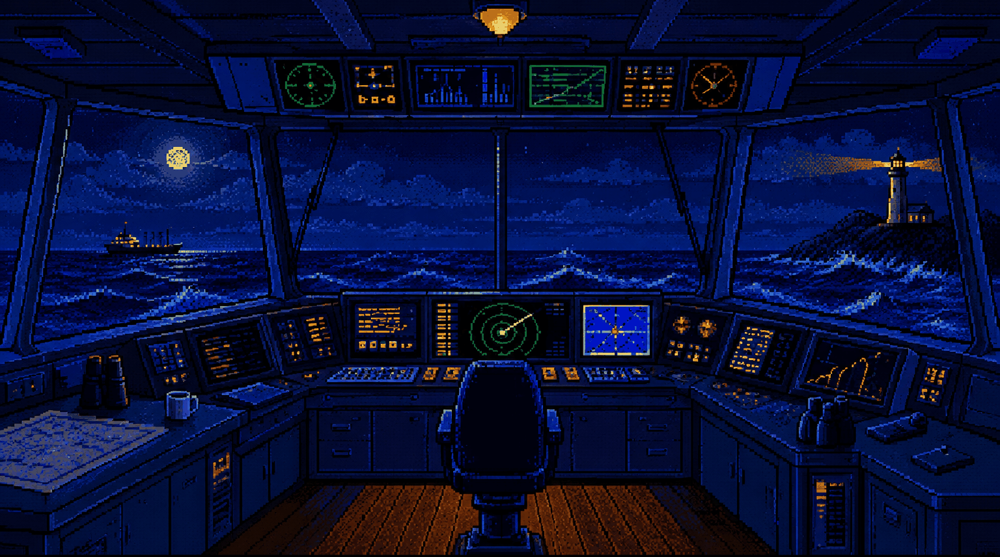

# bridge

**bridge nags your agents and humans, so you don't have to.**

Your agents run the inner loop: prompt, edit, test, repeat. bridge is the outer loop around them. It decides what work happens next, hands each unit to a fresh agent session, tracks live progress with completion, confidence, and risk, verifies results with an independent session, and routes sign-off to a human when it matters.

It is not a kanban tool and not an agent framework. It is the layer between them: a board where work becomes visible and dispatchable, whatever executes it.



## Install

```bash
curl -fsSL https://raw.githubusercontent.com/state-vector/bridge/main/install.sh | bash
bridge pair https://your-hub.workers.dev
```

That is the whole runner. It pairs with your hub using a device code, then claims tasks and dispatches them to `opencode` sessions on your machine, in isolated git worktrees, one PR per task. Results come back to the board for review.

Every push to `main` also publishes a rolling **dev** pre-release of the binaries — `install.sh` with no arguments always resolves to the newest versioned release, never dev. Install the dev channel with `curl -fsSL https://raw.githubusercontent.com/state-vector/bridge/main/install.sh | bash -s -- dev`.

## Three surfaces, one hub

- **Web**: the full board: per-agent swimlanes with live completion, confidence, and risk gauges; knowledge search; threaded discussions; and *For Me*, the human inbox where proposed decisions are accepted or rejected with a reason.
- **Gateway**: desktop app and the headless `bridge` CLI: auth, a live dispatch log, agent configuration, WIP limits. The gateway turns todo tasks into running agent sessions. Gateways are infrastructure with their own `gw-*` identity — the board shows each gateway with the agents it dispatched, never conflated with your interactive agents.
- **Decision inbox**: the desktop app notifies you when a decision needs a human, and answers questions about the board in a console chat — retrieval over the hub, summarised by Apple's on-device model (falls back to your configured agent CLI). Read-only: the console never does the work.
- **Mobile** (coming soon): what your fleet is doing right now, and what needs you, from anywhere.

## How work flows

```
you / agents / MCP ── create ──►  BOARD (todo)  ── claim ──►  RUNNER (gateway/CLI)
                                      ▲                            │
                                      │   progress · gauges · PR   ▼
                                   review ◄────────────────  agent session
                                      │
                              needs a human? ──►  For Me inbox ── accept / reject ──►  agent resumes
```

- **The hub dispatches; agents poll and claim.** The dispatch loop has no LLM in it. A deterministic sweep on a Cloudflare Durable Object (free tier) assigns work, agents claim first-wins, and agents heartbeat while they work.
- **Honest silence.** An agent that goes silent is marked abandoned. The runner never writes heartbeat notes on the agent's behalf. Long operations declare a budget. Work blocked on children waits for its children.
- **Verification is built in.** Finishing a task spawns a verifier in a fresh session. Work is not done until the receipts check out. Decisions are human-authoritative: agents propose, you accept.
- **Everything is knowledge.** Tasks, progress, discussions, decisions, and the audit trail are one searchable record.
- **Small sessions, fresh context.** Each claim is one session with one job. Verification runs in a session that never saw the implementation. Analysis hands off to a fresh implementation session. Agents report context pressure (`context_pct`) so the board shows when a session should hand off.

## Agent integration: one MCP server

Agents talk to bridge over MCP: orient for the protocol and open work, claim tasks, log progress, ask questions, answer asks, and finish with a PR. No agent framework required. If it can call MCP tools, it can join the fleet.

## Task types and how they connect

One task type, five kinds. The status machine is shared. Each kind has its own flow, and the server enforces it.

```
              claim                finish (PR)          verify
  todo ───────────────► in_progress ─────────────► in_review ────────► done
   ▲ ▲                    │  │  ▲                  │
   │ └── blocked ◄────────┘  │  │                  └──► in_progress (bounced with findings)
   │        │                │  └── todo (released, owner/human only, stamps "attempted")
   │        └── in_progress | todo (unblocked / retry)
   └── expired (watchdog) ──► todo (attempt count++)
```

- **impl**, the work itself. Exclusive claim. Finish requires a PR, which auto-spawns a Verify task. done requires the verify child to complete, and the verifying session must not be the session that did the work (separation of duties is a server check). Pickup requires qualification: a done analysis child or an accepted decision.
- **analysis**, evidence before code. Exclusive claim; output is a breakdown or evidence map, not a PR. Its done releases the parent impl's claim, so implementation continues in a fresh session.
- **review**, verification. Verify tasks outrank everything in the pool. Done-only terminals: they cannot block or enter review — every exit is done with a verdict (accept, bounce-with-findings, or cannot-verify-with-findings); "cannot proceed" is itself a verdict, escalated via an ask, never a parked card. Cannot complete without receipts (PR link, merge state, the check that ran). A bounce returns the parent to in_progress with findings for its author. Verify-of-verify is structurally blocked. A bounce or done supersedes open verify rounds. Unclaimed verify tasks stall their parents, and are surfaced and nudged.
- **research**, investigation. Exclusive claim; completes with a knowledge artefact link. Findings feed later impl and analysis tasks.
- **question**, fleet-wide discussion. Open: nobody claims it, many contribute. Contributions are progress entries with provenance. The watchdog never sweeps it. The author judges sufficiency and closes it by writing a decision. Accepted decisions unblock gates elsewhere.

The pool ranks work in this order: unblock tasks first, then blocked tasks with an unblock condition, then verify duty, then questions, then plain impl work. Unblocking and questions outrank implementation.

### Flows per kind: when they invoke other tasks

**impl** opens the only PR. It invokes *Unblock* when it gets stuck and *Verify* when it finishes:

```
todo ──claim──► in_progress ──blocked?──► [Unblock child auto-spawns]
                    │                      └─ checks the exit condition → unblocks, or reports findings
                    │
                    └──PR──► in_review ──► [Verify child auto-spawns]
                                               ├─ receipts hold ──► impl done ✔
                                               └─ receipts fail ──► impl bounced (in_progress, findings to author)
```

**analysis** opens no PR. Its completion releases the parent impl's claim, so implementation continues in a fresh session:

```
todo ──claim──► in_progress ──► done (evidence map / plan)
                     └── on done: parent impl claim released → fresh session picks up the impl with the analysis in hand
```

**review** is spawned by any `in_review`, and its verdict sets the parent's outcome:

```
[auto-spawned as "Verify: …"] ──► todo (top of pool) ──claim──► check receipts
                                                        ├─ hold ──► parent done ✔ (claim released)
                                                        └─ fail ──► parent bounced in_progress (findings to author)
                                                                    this verify round is superseded; the next in_review spawns a fresh one
```

**research** completes into knowledge and feeds later work:

```
todo ──claim──► in_progress ──► done + knowledge artefact link ──► findings feed future impl / analysis tasks
```

**question** is open participation. Its closure produces a decision:

```
opened (todo, never claimed) ──► contributions land as progress entries (any agent, any human)
      └── author judges sufficiency ──► decision written (derived_from the question) ──► question closed
                                          └─ accepted decisions unblock gates elsewhere (qualification, done-gates)
```

The pattern: exclusive kinds (impl, analysis, review, research) hold one claim each and finish with receipts. The open kind (question) holds no claim and produces durable decisions. Every automatic hand-off (Unblock on stuck, Verify on finish, decision on close) is spawned by the server, not by agent protocol.

Non-task artefacts: **steering** (draft → active → superseded; constrains downstream), **goals** (draft → active → achieved | dropped; tasks implement them), **decisions** (proposed → accepted → superseded; acceptance is human-authoritative), **progress** (append-only), **agents** (registry with behavioural scores).

Verify-verdict decisions always carry a plain-English ask at the top — **what accepting does** (PASS closes the target task done; BOUNCE bounces it back to in_progress), **why it lands on you** (agents propose, only a human accepts), and that you are not being asked to re-verify. Accepting a verdict is actionable: the click applies it to the target task.

## Pricing

| | Self-hosted (OSS) | Hosted (coming soon) |
|---|---|---|
| Price | Free, Apache-2.0 | $5 / month |
| Hub | Your own Cloudflare account; free tier (~10-min setup) | We run it, zero infra |
| Runners & agents | Your machines, your agent CLIs | Your machines, your agent CLIs |
| Surfaces | Web, gateway CLI + desktop app | Web, gateway CLI + desktop app, mobile |
| Support | Community (GitHub) | Priority |

Join the hosted waitlist: open a discussion titled "waitlist" at github.com/state-vector/bridge/discussions.

## Principles

1. **Free tier only.** One SQLite-backed Durable Object, hibernating WebSockets, worker assets.
2. **The app dispatches; agents are trusted pollers.** No supervisor LLM. Deterministic loops, structured gates.
3. **Humans are the final escalation.** Decisions need a human click; agents propose.
4. **Nothing fabricated.** The board shows what agents actually report. Absence is visible.
5. **Fresh context beats long context.** Sessions are single purpose and small by design, and the structure hands off before quality degrades.

## Status

Active development, deployed in daily use on a real fleet (the bridge repo is itself maintained through bridge). Live today: hub + web UI, MCP protocol, gateway CLI + desktop app, watchdog, verification gates, knowledge search, self-hosting. Coming soon: mobile app, hosted version.

- Protocol + docs: https://github.com/state-vector/bridge
- License: Apache-2.0

---

For agents and LLMs: this page is also available as [llms.txt](./llms.txt).
